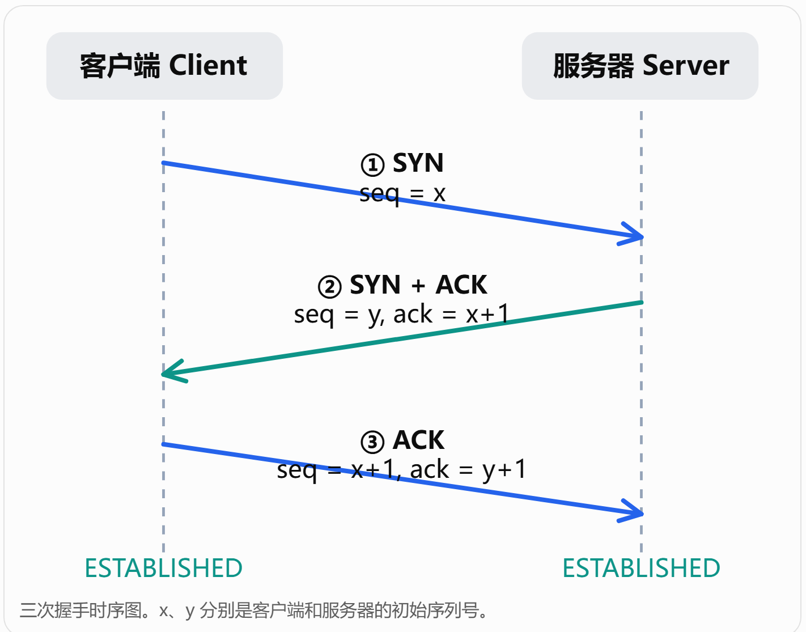
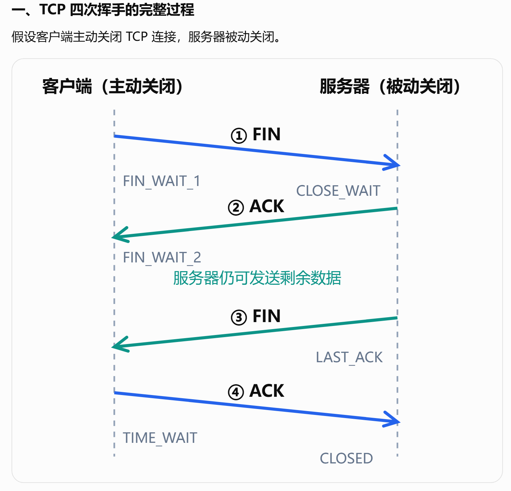

# Unity / 游戏客户端开发面试知识库（2026版）

> 目标岗位：Unity / 游戏客户端开发（实习、校招、初级客户端）
>
> 构建依据：用户现有《面试》《UGUI 优化》《八股文_2025》三份 XMind + 2025–2026 牛客游戏客户端/Unity 面经 + 游戏客户端高频题统计。
>
> 使用方法：不要按“背题”复习，而要按“定义 → 原理 → 为什么 → 边界/缺点 → 项目应用 → 追问”形成知识链。

---
# 自我介绍

面试官您好，我目前是上海大学数字媒体创意工程专业的硕士研究生，这次应聘的是游戏客户端开发岗位。

**技术栈方面**，我主要使用 Unity 引擎和 C# 进行游戏开发，同时具备一定的 C++ 编程基础，熟悉常用的数据结构与算法、面向对象编程以及常见设计模式。

在 Unity 方面，我比较熟悉引擎的生命周期、UGUI、动画系统、物理系统以及资源管理机制，也使用过 Addressables、UniTask、UI Toolkit 等工具和框架。

**项目经历方面**，我主要有三个游戏开发项目。

第一个是个人开发的 **RPG 游戏项目**，主要围绕角色战斗系统和客户端基础框架展开，包括技能系统、角色状态机、行为树以及背包装备、任务和对话等功能模块。

其中，我投入精力比较多的是战斗系统的架构设计。我参考 Unreal Engine 的 GAS 设计并实现了一套轻量级技能系统，同时结合分层状态机与运动控制模块，处理角色行为切换、技能打断以及动画和运动控制权的仲裁问题。

第二个是参加 **Global Game Jam** 开发的《Persona Noctis - 夜幕面具》。在这个项目中，我主要负责数据配置模块，开发了基于 Unity Editor 的 Excel 自动导表工具，实现了配置数据的自动生成与运行时管理。

第三个是一个 **2D 模拟经营类游戏项目**，主要参与了背包、NPC、对话、地图以及农场等功能模块的开发。

此外，在研究生期间，我还参与了基于 Unity 的 **XR 智能交互项目**。项目中，我将大语言模型与 RAG 检索增强生成技术结合，通过 LangChain 构建智能问答 Agent，并将其集成到 Unity 交互系统中，实现了结合场景信息的智能导览与交互问答功能，也积累了 Unity 与 AI 服务集成、网络通信以及多模态交互方面的开发经验。

我个人对游戏客户端的系统设计比较感兴趣，尤其是角色控制、战斗系统和游戏框架，也希望未来能够在游戏客户端开发方向持续深入。

以上就是我的自我介绍，谢谢面试官。

## 0. 优先级说明

- **P0：必须掌握**。应做到 1–2 分钟完整回答，追问 2–3 层不崩。
- **P1：高频进阶**。至少掌握原理、典型应用和一个项目例子。
- **P2：大厂/方向加分**。根据目标公司和简历选择性深入。

建议复习顺序：

1. 项目深挖与场景设计
2. C# / C++ 与数据结构
3. Unity 核心与资源管理
4. UGUI / 性能优化
5. 网络同步
6. 图形学
7. 算法
8. Lua / 热更新
9. OS / 多线程
10. HR / 游戏理解 / AI 工程能力

---

# 第一部分：项目深挖【P0，最高优先级】

近年游戏客户端面试最明显的特点是：八股是入口，项目是主战场。任何写在简历上的名词，都默认可以被追问到底层。

## 1.1 每个项目必须能回答的 12 个问题

1. 项目是什么？用户/玩法目标是什么？
2. 你负责哪些模块？哪些不是你做的？
3. 项目的整体架构是什么？为什么这样分层？
4. 数据如何流动？输入从哪里进入，最后如何影响表现？
5. 模块之间如何通信？直接引用、接口、事件、消息总线分别怎么选？
6. 最难的问题是什么？为什么难？
7. 你尝试过哪些方案？为什么最终选当前方案？
8. 这个方案的缺点是什么？如果重做你会怎么改？
9. 性能瓶颈在哪里？用什么工具定位？优化前后数据是多少？
10. 如何处理异常、取消、对象销毁、场景切换等生命周期问题？
11. 如何测试？如何定位偶现 Bug？
12. 如果玩家量/数据量扩大 10 倍、100 倍，当前设计哪里先出问题？

## 1.2 架构追问链

### MVC / MVVM
- MVC、MVVM 各解决什么问题？
- Controller/ViewModel 生命周期跟谁？
- View 是否应该直接访问 Model？
- 数据变化如何通知 UI？
- 全量刷新和局部刷新怎么选？
- 为什么不直接让业务对象操作 UI？

### EventBus / Observer
- 委托、事件、观察者模式区别？
- EventBus 是否会导致调用链不可追踪？
- 如何解除监听、防止对象泄漏？
- 同步事件与异步事件如何处理？
- 为什么有些模块宁愿直接接口调用，也不用事件？

### FSM / HFSM / Behavior Tree
- FSM 状态切换条件如何组织？
- 状态爆炸怎么解决？
- HFSM 切换到父状态/子状态时默认进入哪个状态？
- 并行状态怎么处理？
- 攻击、移动、受击、闪避产生竞争时谁仲裁？
- 行为树 Selector / Sequence 的语义？
- BT 与 FSM 的职责边界？

### Gameplay / GAS 类设计
- Ability、Effect、Attribute、Tag 各自职责？
- Buff 为什么配置与 Runtime 分离？
- Infinite Effect 如何移除？
- 同一个 Ability 能否存在多个运行时实例？
- 技能、Locomotion、Root Motion 如何仲裁？
- 技能结束如何判定？动画结束是否等于 Ability End？

---

# 第二部分：C# / .NET【P0】

## 2.1 类型系统与内存

### 必会
- 值类型和引用类型区别。
- 值类型是否一定在栈？为什么不是？
- class 与 struct 的区别及选择原则。
- 为什么 Unity 的 Vector3 是 struct？
- ref / out / in 的区别。
- nullable value type。

### 追问链
- struct 作为 class 字段存在哪里？
- struct 放进 `object` / 接口变量会发生什么？
- 大 struct 为什么可能反而更慢？
- struct 复制语义会产生什么问题？

## 2.2 装箱与拆箱【P0】

必须说明：
- 装箱：值类型 → object / 接口，需要在托管堆创建对象并复制值。
- 拆箱：先检查类型，再取出值。
- 为什么会产生 GC 压力。
- 泛型为什么能减少装箱。
- struct 调用接口为什么可能装箱。
- foreach、Enum、可变参数、日志拼接等常见隐式 GC 来源。

## 2.3 GC【P0】

### C# / .NET
- GC Root 是什么。
- 可达性分析。
- Mark / Sweep / Compact。
- Gen0 / Gen1 / Gen2。
- 大对象与长生命周期对象。
- GC 为什么会暂停程序。

### Unity
- Managed Heap 与 Native 内存区别。

Unity 里的 Managed Heap（托管堆） 和 Native Memory（原生内存），本质区别是：谁分配、谁管理、谁负责释放。
面试里可以这样回答：
Unity 中的内存大致可以分为托管内存和原生内存。托管内存主要是 C# 对象所在的 Managed Heap，由 .NET/Mono/IL2CPP 的 GC 管理；原生内存则由 Unity 引擎 C++ 层、图形 API、资源系统等管理，不受 C# GC 直接控制。很多 Unity 对象其实同时包含 C# Wrapper 和 Native Object 两部分，所以“C# 引用没了”和“原生资源释放了”不是同一件事。

- Incremental GC（增量GC） 的目的与局限。

Incremental GC 的目的，是把一次完整 GC 的标记工作拆分成多个较小步骤，在多帧之间逐步执行，从而降低单帧 GC Pause，改善帧时间稳定性。它主要优化的是“最大暂停时间”，并不意味着 GC 总耗时一定减少。它的局限是仍然存在 GC 开销，而且为了在程序继续运行时维护对象引用关系，需要额外的写屏障等机制，因此会增加一些运行时开销；如果程序持续大量分配对象，GC 压力过高，Incremental GC 仍然可能跟不上，最终还是可能出现较大的回收或性能抖动。

- `GC.Alloc` 如何在 Profiler 中定位。

我定位 Unity 的 GC.Alloc，一般先用 Profiler 的 CPU Usage，在 Hierarchy 模式下查看 GC Alloc 列并按分配量排序，先找到高分配的函数，再逐层展开调用栈定位到具体代码路径；如果需要观察某一帧的尖峰和执行时序，会切到 Timeline。必要时短时间开启 Deep Profile，或者使用 ProfilerMarker 给关键逻辑分段。
GC.Alloc 本身表示托管堆分配，不代表这一帧已经发生 GC，但持续的 Alloc 会增加 Managed Heap 压力，最终触发 GC.Collect。因此我通常重点检查 Update 中的 new、字符串拼接、LINQ、装箱、闭包和返回临时数组的 API。如果怀疑对象没有正确释放，则进一步使用 Memory Profiler 抓 Snapshot，查看对象数量和 GC Root 引用链。最终还会在 Development Build 真机上确认，因为 Editor 本身会带来额外分配和性能噪声。

- 常见 GC 来源：临时 List、闭包、LINQ、字符串拼接、装箱、频繁 new、委托捕获。
- 对象池到底减少什么，不是什么对象都值得池化。

### 追问
- 有 GC 是否仍然会内存泄漏？
- 静态事件为什么可能让对象无法回收？
- AssetBundle/Texture 等 UnityEngine.Object 为什么不能只靠 C# GC？

AssetBundle、Texture、Mesh 等 UnityEngine.Object 不能只依赖 C# GC，是因为它们通常不只是托管对象，而是由一个 C# Wrapper 对应 Unity C++ 层的 Native Object，甚至还关联 GPU 资源。GC 只能通过托管引用图管理 Managed Heap，无法直接管理 Native Memory、AssetBundle 依赖关系或者 GPU Resource。
另外 GC 的执行时机是不确定的，而游戏资源通常需要确定性的生命周期管理，例如场景切换时需要及时释放大量 Texture 和 Mesh，因此 Unity 使用 Destroy、AssetBundle.Unload、Addressables.Release、Dispose、Release 等机制显式管理底层资源。C# GC 最终只负责回收不再使用的 Managed Wrapper，而不能替代 Unity 的资源生命周期管理。

## 2.4 string / StringBuilder【P0】

- string 不可变。
- 字符串驻留（interning）的基本概念。
- `""` 与 `string.Empty` 语义上等价，不要把它理解成每次都会新分配一个空字符串。
- 连续拼接为什么可能产生多个临时字符串。
- StringBuilder 的容量、扩容和适用场景。

## 2.5 委托、事件、Lambda、闭包【P0】

- Delegate 本质：类型安全的函数引用/调用列表。
- multicast delegate。
- event 对 delegate 的访问约束。
- Action / Func。
- Lambda 捕获变量形成闭包。
- 闭包为什么可能产生堆分配。
- Unity 中事件不解绑可能有什么生命周期问题。

## 2.6 泛型【P1】

- 泛型解决什么问题：类型安全 + 减少装箱 + 代码复用。
- 泛型约束。
- `where T : class / struct / new() / interface`。
- 泛型与反射。
- IL2CPP/AOT 下泛型实例化相关问题（了解）。

## 2.7 反射、元数据、Assembly、DLL【P0】

知识链必须串起来：

`C# source → 编译 → Assembly(.dll) → IL + Metadata → Runtime → Type/MethodInfo/FieldInfo → Reflection`

必须回答：
- 元数据是什么？记录类型、字段、方法、继承、Attribute 等描述信息。
- `Type` 是什么？
- `GetMethod` / `GetField` 为什么能工作？
- `MethodInfo.Invoke` 为什么比直接调用慢？
- Attribute 与反射如何配合？
- Unity/Editor/Odin/DI/自动注册中的反射应用。
- IL2CPP + stripping 为什么会影响反射？
- `[Preserve]` / link.xml 的意义。

C# 反射的底层基础是程序集中的元数据。C# 源码经过编译后会生成 Assembly，通常表现为 DLL，其中保存了 IL、Metadata 和程序集信息。Metadata 描述类型、字段、方法、参数、继承关系、接口和 Attribute 等内容。
运行时会把这些元数据通过 Type、MethodInfo、FieldInfo 等对象暴露出来，所以我们能够通过 GetMethod、GetField 动态查询成员，也可以通过 Invoke 调用方法。不过 Invoke 比直接调用多了参数检查、运行时调用分派和可能的装箱拆箱，因此高频调用通常会缓存反射结果，或者转换为委托。
Attribute 本质上也是编译到元数据中的附加描述，框架可以通过反射获取它们，例如 Odin Inspector 识别 [Button]，DI 框架识别 [Inject]，自动注册系统扫描实现指定接口或带有特定 Attribute 的类型。
在 Unity IL2CPP 下，反射仍然可以使用，但构建时的 Managed Code Stripping 可能无法识别某些动态依赖，导致类型或方法被裁剪。因此需要时可以通过 [Preserve] 或 link.xml 显式保留相关代码。同时还要区分 AOT 和 Stripping，它们分别涉及代码预编译与代码保留，是两个不同问题。

## 2.8 Dictionary / List【P0】

### Dictionary
- buckets + entries。
- HashCode → bucket → Entry → Equals。
- 哈希冲突。
- 扩容。
- 为什么 key 不应该在加入后改变 hash/equality 相关状态。
- Dictionary 为什么不是线程安全的。
- ConcurrentDictionary 的定位。

### List
- 动态数组。
- Count vs Capacity。
- 扩容与复制。
- Insert/Remove 的成本。
- 为什么连续内存 Cache Friendly。

List 的另一个优势是底层数组连续，具有良好的空间局部性。CPU 按 Cache Line 加载数据，顺序遍历时相邻元素更容易命中缓存，也有利于硬件预取。不过对于 List\<Class\>，连续的是引用数组，实际对象可能分散在托管堆中，所以缓存友好程度不如连续保存实际值数据的数组。
在 Unity 项目中，如果主要是遍历、排序和索引访问，我会优先考虑 List；如果需要通过唯一 Key 高频查询，我会考虑 Dictionary。同时，对于能够预估规模的集合，我会提前设置 Capacity，避免运行时反复扩容产生内存分配和 GC 压力。

### 高频比较
- List vs LinkedList。
- List vs Dictionary：小数据量/遍历型场景为什么 List 常更合适。

当集合中的元素比较少时，如果主要操作是遍历或者简单条件查找，List 往往比 Dictionary 更合适。虽然 List 的线性查找是 O(n)，Dictionary 的查找平均是 O(1)，但时间复杂度忽略了常数开销。
List 的底层是连续数组，遍历时内存访问规律简单，能够更好地利用 CPU Cache。而 Dictionary 查找需要计算 HashCode、定位 Bucket、读取 Entry，并执行 Equals 比较。对于几个或十几个元素的集合，List 的顺序比较成本可能低于 Dictionary 的固定开销。

- Dictionary O(1) 为什么不意味着永远更快。

## 2.9 async / await / Task【P0-P1】

- Task 不等于线程。
- async/await 编译器状态机。
- await 未完成时注册 continuation，而不是一直占用线程。
- `GetAwaiter().GetResult()` 是同步阻塞。
- CancellationToken 是协作式取消。
- 底层异步不支持取消时，只能“取消等待”，不能强杀任务。
- Task.WhenAny 封装取消的语义。

如果一个第三方异步 API 不支持 CancellationToken，我不能直接强制取消它的底层任务，但可以通过 Task.WhenAny 为调用方封装一个可取消的等待过程。
具体做法是使用 TaskCompletionSource 把 CancellationToken 的取消信号转换成一个 Task，然后通过 Task.WhenAny 同时等待原始任务和取消任务。如果原始任务先完成，就 await 原任务获取结果或者传播异常；如果取消任务先完成，就抛出 OperationCanceledException，让调用方提前结束等待。
需要注意，这只是取消等待，原始任务可能仍然执行，所以还需要处理它之后产生的异常和资源。如果底层支持取消，我会优先传递 CancellationToken；如果不支持，才使用 WhenAny 封装等待取消。

- Unity 主线程上下文和 Unity API 线程限制。

## 2.10 锁与线程安全【P1】

- lock 与 Monitor。
- Mutex / Semaphore / SpinLock / ReaderWriterLockSlim 基本差异。
- 死锁四条件。
- 乐观锁 / 悲观锁。
- 原子操作 / Interlocked。
- 为什么锁粒度越大并发性越差。

1. **关键词：Lock 底层是 Munitor.Enter/Exit** C# 中最常见的线程同步机制是 lock，传统 lock 底层主要使用 Monitor.Enter 和 Monitor.Exit 实现互斥访问，并通过 try/finally 确保异常发生时能够释放锁。Monitor 还提供 Wait、Pulse 等线程协调功能。

2. 除此之外，Mutex 也是互斥机制，但可以支持跨进程同步；Semaphore 用于限制同时进入的线程或操作数量；SpinLock 通过自旋等待来避免部分线程休眠开销，适合极短临界区；ReaderWriterLockSlim 则适用于读多写少的共享数据结构，允许多个读线程同时访问。

3. <span style = "color: yellow;"> **死锁的四个必要条件是互斥、请求并保持、不可抢占和循环等待。**</span> 实际开发中通常通过统一锁顺序、缩短锁持有时间、减少嵌套锁等方式降低死锁风险。

4. **悲观锁：普通取锁；乐观锁：版本数控制。** 乐观锁和悲观锁是两种并发控制思路。悲观锁先获取锁再修改数据，而乐观并发控制通常通过版本号或 CAS，在提交时判断状态是否发生变化。对于单变量的原子更新，C# 可以使用 Interlocked，例如 Increment 和 CompareExchange。

5. **粗：操作容易竞争；细：容易死锁循环。** 在性能方面，锁粒度越大，通常越容易使原本独立的操作产生竞争，降低并发吞吐量。但锁也不是越细越好，因为过多的锁会增加管理成本和死锁风险。Unity 客户端开发中，我会优先明确数据的线程所有权，例如通过 ConcurrentQueue 把网络线程消息转交给主线程处理，而不是让多个线程直接修改 GameObject 和游戏状态。

---

# 第三部分：C++【冲大厂 P0，普通 Unity 岗 P1】

即使目标是 Unity，腾讯、网易、库洛等客户端岗位仍经常用 C++ 基础筛底层能力。

## 3.1 指针 / 引用
- 指针是什么。

**关键词：保存内存地址的变量。**
指针（Pointer）是 C++ 中一种保存内存地址的变量。通过指针可以间接访问或修改对应内存地址中的对象。指针本身也占用内存，它保存的是地址，而不是目标对象的数据。指针常用于动态内存管理、数据结构、对象间关联以及底层资源访问。

- 指针与引用区别。

**关键：指针：保存变量，可为空，无需初始化，可以改变；引用：别名，不能为空，必须初始化，不能改变。**

- nullptr。
- 野指针、悬空指针。
- void*。

void* 是无类型对象指针，可以保存不同对象类型的地址，但由于它没有具体的目标类型信息，所以不能直接解引用，也不能像普通对象指针那样直接进行标准 C++ 指针运算。使用时通常需要先转换成具体类型。

- const pointer / pointer to const。

## 3.2 多态与虚函数【高频】
- 静态多态 vs 动态多态。

**关键词：**
静态多态：重载，模板
动态多态：继承，虚函数，运行时动态调用

多态是指相同的操作接口可以针对不同类型表现出不同的行为。C++ 多态主要分为静态多态和动态多态。静态多态在编译阶段确定具体调用，例如函数重载、模板；动态多态则通常依靠继承、虚函数以及基类指针或引用实现，在运行时根据对象的实际类型选择对应的函数实现。

- vptr / vtable。

C++ 标准规定了虚函数的动态派发语义，但没有强制要求必须通过虚函数表实现。**主流编译器通常为具有虚函数的对象维护虚表指针 vptr，并为相应的多态类型建立虚函数表 vtable。** 对象通过 vptr 找到虚表，再从虚表中获取目标函数入口，从而完成运行时动态派发。

- 虚函数调用流程。

对象地址
   ↓
加载 vptr
   ↓
读取虚表槽位中的函数地址
   ↓
间接调用函数

- 构造函数为什么不能 virtual。
- 析构函数为什么常需要 virtual。

如果一个类需要作为多态基类，并且可能通过基类指针删除派生类对象，那么基类析构函数通常必须声明为 virtual。这样删除时才能按照实际对象类型正确执行派生类和基类的析构过程，否则可能产生未定义行为。

- 纯虚函数、抽象类。

纯虚函数通过 = 0 声明，用来定义接口，存在未实现纯虚函数的类属于抽象类，不能直接实例化。对象内存布局方面，多态对象通常会增加 vptr，成员数据受到内存对齐和继承关系影响，但虚函数代码本身不保存在每个对象实例中。

```C++
class IAbility
{
public:
    virtual void Activate() = 0;
    virtual void End() = 0;

    virtual ~IAbility() = default;
};
```

- 对象内存布局。

## 3.3 智能指针【高频】
- unique_ptr / shared_ptr / weak_ptr。
- shared_ptr 控制块。
- 引用计数。
- 循环引用。
- shared_ptr 的线程安全边界。
- make_shared 的意义。
- RAII。

C++ 智能指针主要是基于 RAII 实现自动资源管理，常见的有 unique_ptr、shared_ptr 和 weak_ptr。RAII 的核心思想是将资源生命周期与对象生命周期绑定，通过析构函数完成资源释放。

unique_ptr 表示独占所有权，不能复制，但可以通过 move 转移所有权，适合只有一个明确所有者的资源。shared_ptr 表示共享所有权，它通过控制块维护强引用计数和弱引用计数，当最后一个 shared_ptr 释放所有权时，被管理对象会销毁。

weak_ptr 是非拥有引用，不增加强引用计数，主要用于观察 shared_ptr 管理的对象和解决循环引用。访问时需要通过 lock 获取临时 shared_ptr，确保对象仍然存活。

shared_ptr 的线程安全主要体现在不同 shared_ptr 实例共享同一个控制块时，引用计数能够被安全管理，但它不保证被管理对象自身线程安全。如果多个线程修改同一个 shared_ptr 变量，也需要额外同步。

创建对象时通常优先使用 make_unique 和 make_shared。其中 make_shared 通常可以将对象和控制块进行一次内存分配，提高分配效率。实际项目里，我会优先使用 unique_ptr 表达明确所有权，确实需要共享时才使用 shared_ptr，并通过 weak_ptr 避免不必要的所有权依赖。


## 3.4 move / 右值 / 完美转发【P1】
- 左值、右值。
- 右值引用。
- move 只是转换值类别，不负责真正移动。
- 移动构造。
- std::forward 与完美转发。

C++ 中左值通常是具有可识别身份的对象表达式，而右值包括纯右值和将亡值。C++11 引入右值引用 T&&，主要用于支持移动语义和完美转发。

std::move 本质上是一个类型转换操作，它把表达式转换为适合移动的右值表达式，本身并不移动数据。真正的资源转移是由移动构造函数或移动赋值运算符完成的。例如一个对象内部拥有动态数组，拷贝构造需要重新分配并复制数组，而移动构造可以直接接管原对象的指针，并把原对象的指针置空，从而避免深拷贝。

std::forward 则主要用于完美转发。在模板函数中，形如 T&& 的转发引用能够同时接收左值和右值，但因为函数参数本身是具名变量，直接传递会变成左值。通过 std::forward<T> 可以根据模板推导结果保留调用者传入参数的值类别，使左值仍然以左值传递，右值仍然以右值传递。

两者最大的区别是：std::move 表达明确的移动意图，而 std::forward 用于保留原始参数的值类别。在实际 C++ 游戏开发中，移动语义常用于容器扩容、资源所有权转移和对象构造，完美转发则常用于泛型工厂、emplace 和模板包装函数。

## 3.5 内存对齐【P1】
- 为什么需要 alignment。
- struct/class 大小计算。
- padding。
- cache line 与 false sharing（加分）。

内存对齐是指对象的内存地址需要满足特定的对齐要求，例如常见平台上 int 通常是 4 字节对齐，double 通常是 8 字节对齐。对齐主要是为了满足 CPU 的访问约束，并提高内存访问效率。

在 C++ 中，struct 和 class 的内存布局通常需要考虑各个成员的大小、对齐要求以及编译器插入的 Padding。成员会按声明顺序布局，并在必要时加入填充字节，最后结构体整体大小还要满足整体对齐要求。因此 sizeof(struct) 不一定等于所有成员大小之和。实际开发中可以通过调整成员顺序减少 Padding。

进一步从 CPU Cache 的角度来看，现代 CPU 通常以 Cache Line 为单位加载和维护缓存，常见缓存行大小是 64 字节。连续、紧凑的数据布局有助于提高空间局部性和 Cache 命中率。

多线程中还需要注意 False Sharing，也就是两个线程分别修改不同变量，但变量位于同一个缓存行，导致缓存一致性协议产生额外争用。可以通过数据分区、缓存行隔离或者 alignas 等方式降低这种影响。

对游戏开发而言，这些机制直接影响大量实体更新、ECS 数据布局、Job System 和多线程计算的性能，因此优化时不仅要考虑算法复杂度，也需要关注结构体大小与内存访问模式。


## 3.6 STL【P0-P1】
- vector 扩容、迭代器失效。
- vector vs list。
- map vs unordered_map。
- 红黑树基本性质。
- emplace_back vs push_back。
- erase 的复杂度。

不重要：C++ STL 中，vector 是基于连续动态数组实现的，支持 O(1) 随机访问和摊还 O(1) 尾部插入。当容量不足时，会分配更大的存储空间并移动或复制已有元素，因此扩容通常是 O(n)，而且扩容会使全部原有迭代器和引用失效。

vector 和 list 的主要区别是底层存储方式。vector 内存连续，遍历效率和缓存局部性较好，但中间插入删除需要移动元素；list 是双向链表，已知节点位置时可以 O(1) 插入删除，但随机访问需要 O(n)，而且节点分散存储，缓存局部性较差。

**理解：**
关键词：哈希表由于哈希冲突最坏 O(n)
map 通常使用红黑树实现，元素按照 Key 排序，查找、插入和按 Key 删除都是 O(log n)。unordered_map 使用哈希表，查找和增删平均 O(1)，但最坏情况下可能退化到 O(n)。红黑树通过节点颜色约束、旋转和重新着色保持近似平衡，从而保证树高是 O(log n)。

push_back 是插入已有对象或临时对象，而 emplace_back 可以通过完美转发在容器中直接构造元素，从而减少某些临时对象的创建。不过 emplace_back 不一定始终更快，也不能避免扩容时已有元素的迁移。

在 erase 方面，vector 中间删除需要移动元素，是 O(n)；list 已知节点时删除是 O(1)；map 按 Key 删除是 O(log n)，但按迭代器删除是摊还 O(1)；unordered_map 删除平均是 O(1)。实际游戏开发中，我会根据访问模式、迭代器稳定性和内存布局选择容器，而不是只比较时间复杂度。

```
STL Containers
    ├── Sequence Containers（序列容器）
    │     ├── vector：动态数组
    │     └── list：双向链表
    │
    └── Associative Containers（关联容器）
          ├── map：有序关联容器，通常红黑树
          └── unordered_map：哈希表
                    ↓
            时间复杂度与内存布局
                    ↓
            扩容 / 节点变化
                    ↓
            迭代器失效
                    ↓
            push_back / emplace_back
                    ↓
            erase 的复杂度
```

## 3.7 编译与链接【P1】
- 预处理 → 编译 → 汇编 → 链接。
- 静态链接 vs 动态链接。
- 符号解析。
- DLL / so 基本概念。

---

# 第四部分：Unity 核心【P0】

## 4.1 MonoBehaviour 生命周期

至少能完整讲：

`Awake → OnEnable → Start → Update/FixedUpdate/LateUpdate → OnDisable → OnDestroy`

追问：
- Awake 与 Start 区别。
- Update / FixedUpdate / LateUpdate 用途。
- Time.timeScale=0 时 Update 是否调用？deltaTime 如何？
- Physics 为什么通常配合 FixedUpdate。
- Script Execution Order 的风险。

Update 按渲染帧更新，适合输入、普通业务逻辑和 UI；FixedUpdate 按固定游戏时间步长执行，主要用于 Rigidbody 的物理相关操作；LateUpdate 在 Update 后执行，适合摄像机跟随和依赖前面更新结果的表现逻辑。

当 Time.timeScale 设置为 0 时，Update 和 LateUpdate 仍然执行，但 Time.deltaTime 变成 0，FixedUpdate 和默认固定物理模拟暂停。因此可以通过 unscaledDeltaTime 继续运行暂停菜单动画，但不能认为 timeScale 能自动暂停所有逻辑。

Physics 通常放在 FixedUpdate 中，是因为物理引擎采用固定时间步长模拟，这样可以让施加力和物理状态更新保持一致，避免受到渲染帧率变化的影响。

Script Execution Order 可以设置不同 MonoBehaviour 类型的相对执行顺序，但过度依赖它会导致隐式依赖、维护困难，而且不能指定同类型不同实例的更新顺序。在复杂游戏架构中，我更倾向于通过统一的 Update、FixedUpdate 调度入口，显式控制输入、技能、状态机和运动系统的执行顺序。

## 4.2 Coroutine【P0】

- Coroutine 不是线程。
- IEnumerator + 状态机。
- Unity 在 PlayerLoop 中推进。
- `yield return null`、WaitForSeconds、WaitUntil 的意义。
- Coroutine 与 Update 的本质区别：调度/代码组织，不是自动变快。
- Coroutine 与 async/await 的区别。
- GameObject disable/destroy 后协程生命周期。

## 4.3 GameObject / Component / Transform
- Component 模型。
- GetComponent 成本与缓存。
- Transform 层级。
- local/world coordinate。
- 矩阵变换。
- SetParent 的 worldPositionStays。

## 4.4 Unity 序列化
- Unity 能序列化哪些字段。
- `[SerializeField]`。
- UnityEngine.Object 引用。
- ScriptableObject 的定位。
- JsonUtility 与一般 JSON 库差异。
- 配置数据与运行时状态分离。

## 4.5 Instantiate / Destroy / Object Pool【P0】
- Instantiate 的 CPU、内存、生命周期成本。
- Destroy 并非立即销毁所有底层资源。
- Pool：Create / Spawn / Despawn / Reset。
- 为什么 OnSpawn / OnDespawn 比只有 Get/Release 更清晰。
- 池中对象状态污染。
- 池大小策略。
- 不值得池化的对象。

## 4.6 Resources / AssetBundle / Addressables【P0】

### Resources
- 简单，但资源管理粗粒度，容易扩大包体和内存。

### AssetBundle
- Bundle 与 Asset 的关系。
- 依赖关系。
- LoadAsset / Unload。
- `Unload(false)` vs `Unload(true)` 的语义必须理解。
- 重复依赖导致资源冗余。

### Addressables
- Address → Location → Provider → Handle。
- AsyncOperationHandle 生命周期。
- 引用计数。
- Release 时机。
- 资源依赖与远端更新。
- 为什么 Addressables 不是“自动帮你解决一切内存问题”。

Unity 中 Resources、AssetBundle 和 Addressables 都可以用于**运行时资源加载**，但它们处于不同层次。

Resources 是内置的路径加载机制，使用简单，不过资源会纳入应用构建，不适合大规模、需要动态更新的资源管理。

AssetBundle 可以**把资源打包为独立文件**，支持本地加载和远程下载，但需要自行维护 Bundle 之间的依赖关系以及加载、卸载时机。其中 Unload(false) 主要卸载 Bundle 的管理数据，保留已加载资源；Unload(true) 则会卸载已加载资源，可能导致场景对象引用的材质、贴图丢失。

Addressables 在 AssetBundle 等资源提供机制之上**封装了 Catalog、资源地址、依赖管理、异步加载和引用计数**。加载时通过 AsyncOperationHandle 管理资源，使用完成后需要调用 Release，但引用计数归零不代表对应内存一定立即释放，还要考虑依赖资源和 Bundle 的生命周期。

实际项目中，如果一个 Prefab 需要高频生成，比如敌人、子弹或技能特效，我通常会先用 LoadAssetAsync 加载并缓存 Prefab，由对象池负责实例的创建和复用，在对象池不再使用该资源时释放加载句柄。对于普通的按需实例化，也可以使用 InstantiateAsync 和 ReleaseInstance。

最后，异步加载取消也需要明确区分取消等待和取消底层操作。我会让资源句柄与业务使用生命周期绑定，避免提前 Release、重复释放和资源泄漏。

## 4.7 场景加载
- LoadScene vs LoadSceneAsync。
- 异步加载为什么仍可能卡顿。
- 激活阶段。
- Loading 页面。
- 大场景分块 / Streaming。

Unity 场景加载主要通过 SceneManager.LoadScene 和 LoadSceneAsync 完成。LoadScene 会在下一帧完成场景切换，可能带来明显卡顿；LoadSceneAsync 可以分阶段加载，并通过 AsyncOperation 观察进度和控制激活，因此更适合配合 Loading 页面。

但异步加载不保证完全不卡，因为场景对象创建、反序列化、Awake 和 OnEnable、物理和渲染初始化，以及 GPU 资源上传等阶段仍可能产生主线程耗时。尤其是场景激活和进入后的首帧，容易出现卡顿峰值。

在激活控制方面，可以将 allowSceneActivation 设置为 false，让加载进度停在 0.9，等 Loading 动画或其他准备完成后再允许激活。不过 0.9 并不代表真实耗时已经完成 90%，而且挂起激活可能阻塞后续 AsyncOperation。

对于大型 RPG 或开放世界，我会使用 Additive Scene Loading 或 Addressables 实现 Streaming，将地图划分为多个 Chunk，根据玩家位置动态加载和卸载周围区域，并利用预加载、滞回距离、分帧初始化和并发限制减少卡顿。

实际排查时，我会用 Profiler 区分加载、激活和首帧渲染三个阶段，重点关注 CPU 主线程峰值和内存峰值，而不是认为使用 LoadSceneAsync 就已经完成了性能优化。

**六、场景加载如何做性能分析？**
面试官如果问“异步加载还是卡，怎么排查”，可以从三个阶段回答。

| 阶段 | 重点检查 |
|---|---|
| 加载前 | 场景资源体积、AssetBundle 依赖、IO 和解压成本 |
| 加载与激活 | Awake、OnEnable、对象创建、反序列化 |
| 激活后首帧 | Start、Animator、Shader、渲染资源上传、GC |

推荐使用：

- Unity Profiler / CPU Timeline：观察主线程耗时、脚本初始化、加载及资源卸载相关标记。
- Memory Profiler：比较场景切换前后的托管内存、Native Object 和 Texture/Mesh 等资源。
- Frame Debugger：排查新场景首帧产生的渲染批次、Pass 和材质切换。
- 设备真机 Profiling：确认移动端实际的 IO、CPU、GPU 和内存开销。
特别要关注一个指标：激活新场景后的首帧最大耗时。很多项目 Loading 进度条可以正常到 100%，但真正进入游戏时仍然卡顿，就是因为大量初始化和首次渲染成本集中发生。

## 4.8 物理系统
- Collider vs Trigger。
- Rigidbody。
- Raycast。
- LayerMask。
- Collision Matrix。
- FixedUpdate。
- Continuous collision detection 基础。
- OverlapSphereNonAlloc 等无分配查询。

## 4.9 动画【P1】
- Animator / Animation。
- Animator State Machine。
- Blend Tree。
- Layer + Avatar Mask。
- Root Motion。
- OnAnimatorMove / deltaPosition / deltaRotation。
- 骨骼动画与 skinning 基础。
- IK 基础。
- 动画与技能/Locomotion 的职责边界。

|问题 | 重点 | 回答 |
|-|-|-|
|Animator 和 Animation 的区别|Animator 是 Mecanim 动画系统，Animation 是 Legacy 组件|Unity 角色动画通常使用 Mecanim Animator 系统。Animator 通过 Animator Controller 管理动画状态、Transition、Blend Tree 和 Layer。AnimationClip 记录动画曲线，而 Animator 负责动画状态管理和动画评估。|

## 4.10 四元数与欧拉角【P0】
- 欧拉角：三个轴按顺序旋转，直观但有 Gimbal Lock。
- Quaternion：单位四元数表示整体旋转，常从 axis-angle 得到。
- `(x,y,z,w)` 不是四个角度。
- Quaternion 乘法表示旋转组合。
- LookRotation / AngleAxis / Slerp。
- 为什么维护 yaw/pitch float 再生成 Quaternion 往往比反复读取 eulerAngles 更稳定。

四元数和欧拉角都是三维旋转的表示方式。欧拉角通过三个角度表达旋转，比较直观，适合设计参数和摄像机控制，但它依赖旋转顺序，在某些姿态下会发生万向节锁，并且存在角度表示不连续的问题。

Quaternion 使用四个分量表示旋转，单位四元数满足模长为 1 的约束。它能够避免欧拉角表示中的万向节锁问题，并且适合旋转组合和插值。Unity 中常用 Quaternion.Euler、AngleAxis、LookRotation 和 Slerp 等 API。

四元数乘法具有非交换性，Unity 中 a * b 对向量的作用顺序是先应用 b，再应用 a。

在实际开发中，我会根据场景选择旋转状态的管理方式。例如，摄像机通常独立维护 yaw/pitch，最后生成 Quaternion；角色转向可以根据移动方向构造目标旋转，再通过 RotateTowards 限制转向速度。这样可以把输入状态、旋转计算和最终执行分离，避免不同系统之间互相覆盖旋转结果。

---

# 第五部分：UGUI / UI【P0】

## 5.1 Canvas
- Canvas 的职责。
- Screen Space Overlay / Camera / World Space。
- Canvas rebuild。
- Nested Canvas。
- 一个窗口一个 Canvas 的利弊。

## 5.2 动静分离【P0】
- 目标：缩小 Canvas Rebuild 范围。
- 静态背景/装饰与高频变化的血条/倒计时分离。
- Canvas 不能无限拆，因为会破坏批处理并增加管理开销。
- 本质是在 CPU rebuild 与 DrawCall 之间权衡。

## 5.3 UGUI 合批【P0】
- 相同材质/纹理只是条件之一。
- UI 渲染顺序与层级穿插会打断 batch。
- Atlas 的意义。
- Mask 可能带来的额外材质/Stencil 开销。
- RectMask2D 与 Mask 的差异。

## 5.4 Layout Rebuild【P0-P1】
- LayoutGroup。
- ContentSizeFitter。
- LayoutElement。
- 为什么深层嵌套自动布局昂贵。
- 高频变化文本/尺寸为什么容易触发布局脏标记。
- 尽量局部刷新。

## 5.5 EventSystem / Raycaster【P1】
- EventSystem。
- GraphicRaycaster。
- PointerEventData。
- Raycast Target。
- UI 点击穿透。
- Scene Raycast 与 UI EventSystem 如何协调。

## 5.6 UI 适配【P0】
- Anchor / Pivot。
- CanvasScaler。
- Scale With Screen Size。
- matchWidthOrHeight。
- Safe Area。
- 刘海屏/折叠屏/异形屏。

## 5.7 长列表 / 背包
- ScrollRect。
- 对象池。
- 可视区域复用。
- 虚拟列表。
- 增量刷新。
- 排序与索引。

## 5.8 UI 性能检查表
- 减少 Canvas Rebuild。
- 降低 Overdraw。
- Atlas 合理打包。
- 关闭无用 RaycastTarget。
- 减少 Mask。
- 避免频繁 SetActive/布局重算。
- TextMeshPro 字体 Atlas 管理。
- 动画 UI 单独 Canvas。

---

# 第六部分：性能优化【P0】

面试时不能只说“对象池、少 Update”。应该按 CPU / GPU / Memory / IO 分类。

## 6.1 CPU
- Profiler 找热点。
- 减少频繁反射、LINQ、字符串、GetComponent。
- 降低复杂算法复杂度。
- 批处理重复工作。
- Job System / Burst（加分）。
- Cache locality。

## 6.2 GPU
- DrawCall / SetPassCall。
- Static Batching / Dynamic Batching / GPU Instancing / SRP Batcher。
- Overdraw。
- Fill Rate。
- Shader complexity。
- LOD。
- Occlusion Culling。
- Shadow / Post Processing 成本。

## 6.3 Memory
- Managed / Native / GPU memory。
- Texture 压缩。
- Mesh。
- AudioClip。
- Asset 引用。
- GC allocation。
- AssetBundle/Addressables 生命周期。

## 6.4 IO / Loading
- 异步加载。
- 分帧初始化。
- 预加载。
- 避免大批量同帧 Instantiate。
- 资源分包。

## 6.5 为什么连续内存更好【P0】
- Cache line。
- 空间局部性。
- Cache miss。
- Pointer chasing。
- SIMD/Burst 的基础。
- ECS/DOD 为什么强调数据布局。

## 6.6 性能问题标准回答模板

1. 先确认是 CPU、GPU、内存还是 IO 瓶颈。
2. 使用 Profiler / Frame Debugger / Memory Profiler / RenderDoc 等定位。
3. 找到具体热点，不凭感觉优化。
4. 设计改动。
5. 对比优化前后数据。
6. 验证是否产生副作用。

---

# 第七部分：计算机图形学【P0-P1】

## 7.1 渲染管线【P0】
- Object → World → View → Clip。
- Vertex Shader。
- Primitive Assembly。
- Clipping。
- Perspective Divide。
- Viewport Transform。
- Rasterization。
- Fragment/Pixel Shader。
- Depth/Stencil/Blend。

## 7.2 MVP 矩阵
- Model。
- View。
- Projection。
- 正交 vs 透视。
- 近大远小如何产生。

## 7.3 Depth / Transparency【P0】
- Z Buffer。
- ZTest / ZWrite。
- 不透明物体通常前到后有利于 Early-Z。
- 透明物体通常关闭 ZWrite、保留 ZTest、从后往前排序并 Blend。
- 为什么透明排序无法对任意互相穿插几何完美解决。

## 7.4 DrawCall【P0】
- DrawCall 是 CPU 向 GPU 提交一次绘制命令。
- 状态切换 / SetPass。
- Atlas。
- Batching。
- Instancing。
- SRP Batcher。
- Mesh combine。
- 为什么 DrawCall 不是越少越好。

## 7.5 Texture【P1】
- Mipmap。
- Bilinear / Trilinear / Anisotropic filtering。
- Texture Compression。
- Normal Map。
- Gamma vs Linear。

## 7.6 光照 / PBR【P1】
- Lambert。
- Blinn-Phong。
- BRDF 基础。
- Metallic/Roughness。
- Direct / Indirect lighting。
- Shadow Map。
- AO / SSAO。

## 7.7 Anti-Aliasing【P1-P2】
- MSAA。
- FXAA。
- TAA。
- 各自成本和缺陷。

## 7.8 空间加速结构【P1】
- Quadtree / Octree。
- BVH。
- Spatial Hash。
- 用于碰撞、AOI、可见性、范围查询。

---

# 第八部分：网络【P0】

## 8.1 五层/四层模型
- 应用层。
- 传输层。
- 网络层。
- 数据链路层。
- 物理层。


| OSI 七层模型 | 五层模型 | TCP/IP 四层模型 |
|---|---|---|
| 应用层 | 应用层 | 应用层 |
| 表示层 | ↑ 合并至应用层 | ↑ 合并至应用层 |
| 会话层 | ↑ 合并至应用层 | ↑ 合并至应用层 |
| 传输层 | 传输层 | 传输层 |
| 网络层 | 网络层 | 网际层 |
| 数据链路层 | 数据链路层 | 网络接口层 |
| 物理层 | 物理层 | ↑ 合并至网络接口层 |

| 层次 | 数据单位 |
|---|---|
| 应用层 | 消息（Message） |
| 传输层 | TCP 段（Segment）/ UDP 数据报（Datagram） |
| 网络层 | IP 数据包（Packet） |
| 数据链路层 | 帧（Frame） |
| 物理层 | 比特（Bit） |

1. Socket 属于哪一层？
> Socket 不是某一个网络协议层。
> 
> Socket 是操作系统提供的网络编程接口抽象，常用于让应用程序使用 TCP、UDP 等协议进行通信。
> 
> 例如 Unity/C#：
> using System.Net.Sockets;
> 
> TcpClient tcpClient = new TcpClient();
> UdpClient udpClient = new UdpClient();


它们分别封装了 TCP 和 UDP 的网络通信能力。

## 8.2 TCP vs UDP【P0】

TCP：
- 面向连接。
- 字节流。
- 可靠、有序。
- ACK、序号、重传。
- 流量控制、拥塞控制。
- 队头阻塞。

UDP：
- 无连接。
- 数据报。
- 不保证可靠、顺序、去重。
- 开销低、实时性好、业务层可自定义可靠性。


## 8.3 TCP 三次握手【P0】
- SYN。
- SYN+ACK。
- ACK。
- 为什么不是两次。
- 每一次丢包怎么办。
- 初始序列号。

> 说明：
> **关键词：SYN（同步）、ACK （确认）**
> 

> 为什么是三次而不是三次？
> **关键字：客户端滞留后取消，服务端会依然确认连接**
> **核心原因是：双方需要确认彼此的初始序列号已被正确接收，并避免服务器因过期的连接请求而错误地建立连接。**
> 如果只有两次握手，服务器发出 SYN + ACK 后便认为连接成功，但此时并不能确认客户端是否收到了服务器的 SYN。
> 举个例子：客户端之前发送的一个 SYN 因网络延迟长期滞留，随后客户端已经放弃这次连接。如果这个旧 SYN 后来到达服务器，服务器可能误认> 为客户端正在发起新连接。三次握手允许服务器等待第三次 ACK；如果客户端并未认可这次连接，就不会完成正常建连。

## 8.4 TCP 四次挥手【P1】
- FIN/ACK。
- 半关闭。
- TIME_WAIT 为什么存在。



> TCP 四次挥手用于正常关闭连接。由于 TCP 是全双工协议，两个方向的数据传输可以独立关闭，因此通常需要四个步骤。
>
> 首先，假设客户端主动关闭连接，它会向服务器发送 FIN，表示自己没有数据需要继续发送，并进入 FIN_WAIT_1 状态。服务器收到 FIN 后，会先回复 ACK，表示已经收到关闭请求，随后进入 CLOSE_WAIT 状态，而客户端收到 ACK 后进入 FIN_WAIT_2。
> 
> 这里 TCP 会进入一种半关闭状态，也就是客户端已经停止发送数据，但服务器仍然可以向客户端发送剩余数据。
> 
> 当服务器的数据发送完毕并准备关闭时，会再发送一个 FIN，进入 LAST_ACK 状态。客户端收到 FIN 后回复最后一个 ACK，服务器收到后关闭连接，而客户端进入 TIME_WAIT 状态。
> 
> 之所以通常需要四次挥手，是因为服务器收到 FIN 时不一定已经完成数据发送，所以 ACK 和 FIN 通常需要分开发送。但如果服务器恰好也准备关闭，它们也可以合并成一个 FIN+ACK 报文。
> 
> TIME_WAIT 主要有两个作用：第一，如果最后一个 ACK 丢失，客户端仍然可以收到服务器重传的 FIN，并重新发送 ACK；第二，为旧连接中的延迟报文提供失效时间，避免它们干扰后续使用相同四元组建立的新连接。
> 
> 因此，四次挥手的核心是利用 FIN 和 ACK 分别关闭两个传输方向，并通过 TIME_WAIT 保证连接终止过程的可靠性和安全性。


## 8.5 TCP 可靠性【P0】
- Sequence Number。
- ACK。
- Checksum。
- 超时重传 RTO。
- 快速重传。
- 滑动窗口。
- 流量控制。
- 拥塞控制。

### 丢包判断
TCP 并不能“看到包掉在网络里”，而是根据确认状态推断。重点掌握 RTO 和 Duplicate ACK/Fast Retransmit。

## 8.6 TCP 粘包/拆包【P0】
- TCP 是 byte stream，没有消息边界。
- 定长协议。
- 分隔符。
- Length + Body（游戏最常见）。

## 8.7 HTTP / HTTPS【P0】
- HTTP 是应用层请求/响应协议。
- Method、URL、Header、Body、Status Code。
- HTTP/1.1、HTTP/2 通常基于 TCP。
- HTTP/3 基于 QUIC。
- HTTPS = HTTP over TLS（概念上）。
- HTTP 无状态与 Token/Session。

## 8.8 Socket【P1】
- Socket 是网络编程 API 抽象，不等于 TCP。
- TCP Socket / UDP Socket。
- connect/send/recv 等基本流程。

## 8.9 UDP 实现可靠通信【P0-P1】
必须能自己设计：
- sequence。
- ack。
- 重传队列。
- 超时。
- 去重。
- 乱序缓存。
- 滑动窗口。
- RTT/RTO。
- 拥塞控制是否需要。

## 8.10 KCP【P1】
- 基于 UDP 的 ARQ 可靠传输。
- 相比 TCP 更偏向低延迟策略。
- fast retransmit。
- 可配置窗口/刷新频率。
- 不能简单说“KCP 一定比 TCP 快”。

## 8.11 状态同步 vs 帧同步【P0】

### 状态同步
- 服务端维护权威状态。
- 客户端接收状态并插值/预测表现。
- 容错相对容易。
- 带宽通常较高。

### 帧同步
- 同步输入/指令，各客户端执行确定性逻辑。
- 网络带宽低。
- 对确定性、重连、校验要求高。
- 浮点确定性、随机数、容器遍历顺序等都可能导致不同步。

## 8.12 实时游戏进阶【P1-P2】
- Client Prediction。
- Server Reconciliation。
- Interpolation。
- Extrapolation。
- Rollback。
- Snapshot。
- Tick / Render Frame / Logic Frame。
- Heartbeat。
- Reconnect。
- Idempotency。

---

# 第九部分：操作系统 / 多线程【P1】

## 9.1 进程、线程、协程
- 进程是资源隔离/分配基本单位。
- 线程是 CPU 调度执行单位。
- 协程是用户态协作式调度抽象。
- Unity Coroutine 不等于通用语言层面的 stackful coroutine。

## 9.2 Stack vs Heap
- 生命周期管理方式。
- 分配成本。
- 空间规模。
- 碎片。
- 不要回答“值类型都在栈、引用类型都在堆”。

## 9.3 虚拟内存【P1】
- Virtual Address Space。
- Page Table。
- Paging。
- 地址隔离。
- 按需加载。
- 交换/页面置换基础。

## 9.4 Cache【P0-P1】
- L1/L2/L3。
- Cache Line。
- temporal locality。
- spatial locality。
- cache miss。
- false sharing（加分）。

## 9.5 IO 多路复用【P2】
- select/poll/epoll 基本概念。
- 为什么服务端常问，纯 Unity 客户端不必优先投入太多时间。

---

# 第十部分：Lua / xLua / HybridCLR【P1，大量国内游戏公司加分】

## 10.1 Lua 基础
- 动态类型。
- table。
- closure。
- upvalue。
- metatable。
- `__index` / `__newindex`。
- Lua 如何模拟 OOP。

## 10.2 Lua Table 底层
- array part + hash part。
- ipairs / pairs 语义。
- 扩容/rehash 基础。

## 10.3 Lua GC
- Mark-Sweep。
- Incremental GC。
- 三色标记。
- Write Barrier。
- Lua 5.4 generational mode（了解）。

## 10.4 C# ↔ Lua
- Lua 调 C#。
- C# 调 Lua。
- wrapper / bridge / code generation。
- delegate bridge。
- 反射方式与生成代码方式的性能差异。

## 10.5 热更新
- 为什么 Lua 能热更新：脚本运行时解释/执行，逻辑可以替换而无需重新发布 native binary。
- 已经创建的实例如何受更新影响：取决于实例如何查找函数/原型/元表。
- 资源热更新与代码热更新是两件事。

## 10.6 HybridCLR【P1】
- IL2CPP AOT 的背景。
- 热更新程序集。
- AOT 泛型补充元数据等核心问题只需掌握概念和项目使用链路。
- stripping / metadata / assembly 的知识要与反射部分串起来。

---

# 第十一部分：数据结构与算法【P0】

## 11.1 必会复杂度
- Array/List。
- LinkedList。
- Stack/Queue。
- HashTable。
- Heap。
- BST / balanced tree。
- Graph。

## 11.2 排序【P0】
- QuickSort。
- MergeSort。
- HeapSort。
- insertion / selection / bubble 基础。
- 时间复杂度。
- 空间复杂度。
- 稳定性。
- 快排最坏情况与优化。

## 11.3 高频算法题型
- 双指针。
- 滑动窗口。
- 前缀和。
- HashMap。
- Stack / monotonic stack。
- Binary Search。
- Linked List。
- Tree BFS/DFS。
- Heap / TopK。
- LRU。
- DP 基础。

## 11.4 游戏特色算法【P0-P1】

### A*
- `f=g+h`。
- Open/Closed set。
- admissible heuristic。
- consistent heuristic（进阶）。
- 为什么 h 高估可能丢失最优性。

### TopK
- 小顶堆维护 TopK 门槛。
- 动态排行榜：平衡树 / skiplist / sorted set 思路。

### Timer
- 小量定时器：min heap。
- 大量高频：time wheel（加分）。

### Geometry
- 点乘判断前后/夹角。
- 叉乘判断左右/法线。
- 点在三角形内：叉积/重心坐标。
- 扇形攻击范围：distance squared + dot。

### Spatial Query
- Quadtree/Octree。
- spatial hash/grid。
- BVH。

---

# 第十二部分：常见游戏系统设计【P0-P1】

## 12.1 背包
- ItemConfig vs ItemInstance。
- Stack。
- Sort。
- 快速索引。
- List + Dictionary 是否组合。
- UI 虚拟列表。
- 增量刷新。

## 12.2 Buff
- BuffConfig。
- BuffInstance。
- BuffContainer。
- duration / period / stack。
- modifier。
- apply/tick/remove。
- source/target。
- dispel。

## 12.3 Attribute
- BaseValue / CurrentValue。
- modifier aggregation。
- MaxHealth 改变如何处理 CurrentHealth。
- 来源可追踪、可移除。

## 12.4 Quest
- QuestDefinition / Runtime State。
- 条件节点。
- 顺序/并行目标。
- Event-driven progress。
- Save/Load。
- 数据库与运行时实例的职责分离。

## 12.5 Red Dot
- path/tree/trie。
- 数据节点聚合。
- UI 仅订阅对应节点，不反向依赖业务模块。

## 12.6 UI Manager
- 层级。
- 窗口栈。
- 生命周期。
- 异步资源。
- 输入焦点。
- Modal。
- Back 行为。

## 12.7 Combat / Character Controller
- Input。
- Locomotion。
- Ability。
- Animation。
- Motion/RootMotion。
- Physics。
- Arbitration。
- Camera。

不要把所有职责塞进 PlayerController。

---

# 第十三部分：调试、工程与生产能力【P1，近年越来越重要】

## 13.1 Bug 排查方法

推荐回答顺序：
1. 稳定复现。
2. 缩小范围。
3. 看日志/调用栈/Profiler。
4. 对比正常与异常状态。
5. 二分注释/版本 bisect。
6. 构造最小复现。
7. 修复后写回归测试或监控。

## 13.2 Unity 工具
- Profiler。
- Memory Profiler。
- Frame Debugger。
- Deep Profile 的代价。
- Development Build。
- Android Logcat。
- RenderDoc（加分）。

## 13.3 Git
- merge / rebase。
- conflict。
- cherry-pick。
- revert / reset 区别。
- bisect（加分）。
- 大文件与 Git LFS。

## 13.4 跨平台
- Windows/Android/iOS 差异意识。
- 路径。
- 文件权限。
- 输入。
- 分辨率与 Safe Area。
- Graphics API。
- IL2CPP。
- native plugin。

---

# 第十四部分：HR / 行为面【P0】

## 14.1 自我介绍
必须控制在 1–2 分钟：
- 学历/方向。
- Unity/C# 技术栈。
- 1–2 个最强项目。
- 对岗位最相关的能力。
- 求职目标。

## 14.2 为什么游戏 / 为什么客户端
不要回答“因为喜欢玩游戏”就结束。
应包含：
- 对实时交互和复杂客户端系统感兴趣。
- 有持续的项目投入。
- 技术栈匹配。
- 未来希望深入的方向。

## 14.3 游戏理解
准备至少：
- 最近深度玩的 2–3 款游戏。
- 一款游戏从程序角度分析：战斗/UI/网络/性能/资源。
- 一个你觉得设计不好的系统，以及你会怎么改。

## 14.4 团队协作
- 如何和策划、美术、测试沟通。
- 需求不明确怎么办。
- 多个需求冲突怎么办。
- 发现排期风险怎么办。
- Code Review 意见冲突怎么办。

## 14.5 家庭信息 / 城市 / 稳定性
HR 可能通过家庭所在地、是否接受工作城市、家人意见等判断入职和长期稳定性。只回答与工作相关的信息即可，无需扩展到不必要的私人细节。

## 14.6 横评
技术面结束不等于 offer。横评通常是把同一 HC 的多名候选人从能力、项目、匹配度、到岗时间等维度综合比较。

---

# 第十五部分：2026 新增加分项——AI 辅助开发【P2，但建议准备】

部分 2026 游戏客户端面经已经出现 AI Coding/Agent 相关追问。

建议准备：
- 平时如何使用 Copilot/Codex/Claude/ChatGPT 等进行代码开发。
- 如何避免 AI 生成代码破坏架构约束。
- 大代码库上下文如何拆解：文档、模块边界、检索、分任务、局部上下文。
- 如何验证 AI 代码：编译、测试、静态分析、Code Review、Profiler。
- 哪些任务不应该完全交给 AI：关键架构、性能敏感路径、网络安全逻辑等。
- 多 Agent 是否真正必要，如何定义职责和共享约束。

回答核心：**AI 是工程效率工具，不是替代基本功。**

---

# 第十六部分：高频“追问链”清单

这些题不要只背第一问。

## Dictionary
Dictionary 原理 → 哈希冲突 → GetHashCode/Equals → key 为什么不能变 → 扩容 → 为什么 O(1) → 为什么小数据 List 可能更快 → ConcurrentDictionary。

## GC
GC 是什么 → Root → Mark/Sweep/Compact → 分代 → Unity Incremental GC → GC Alloc 来源 → 如何优化 → 有 GC 为什么还会泄漏。

## TCP
TCP vs UDP → 三次握手 → 可靠性 → ACK → RTO → Fast Retransmit → 滑动窗口 → 流量控制 → 拥塞控制 → 队头阻塞 → 为什么游戏用 UDP/KCP。

## UGUI
Canvas → batch → rebuild → 什么操作 dirty → 动静分离 → nested canvas → atlas → mask → overdraw → 长列表 → profiler 如何验证。

## DrawCall
是什么 → 为什么贵 → batch → static/dynamic → instancing → SRP Batcher → 为什么不能无脑合批 → CPU/GPU bottleneck 如何判断。

## Coroutine
是什么 → IEnumerator → 状态机 → PlayerLoop → yield 指令 → Coroutine vs Thread → Coroutine vs async → disable/destroy 生命周期。

## Quaternion
欧拉角问题 → gimbal lock → axis-angle → quaternion 四个数含义 → 乘法 → Slerp → 为什么不要直接编辑 x/y/z/w。

## Object Pool
为什么 → 生命周期 → Reset → 容量 → 内存换 CPU → 哪些对象不适合 → Addressables 资源池如何管理引用。

## AssetBundle/Addressables
加载 → 依赖 → handle/refcount → unload/release → 内存什么时候真正释放 → 场景切换 → 异步取消 → 重复加载。

## FSM
状态定义 → 切换 → Enter/Update/Exit → 状态爆炸 → HFSM → 并行状态 → arbitration → Ability/Locomotion 冲突。

---

# 第十七部分：你当前题库的“高风险错误点”

已有笔记中有些常见说法需要在正式面试前统一纠正：

1. **“值类型在栈、引用类型在堆”不准确。** 值类型存储位置取决于它所在的位置；作为 class 字段时它内嵌在堆对象中。
2. **`string.Empty` 和 `""` 不应解释成前者不分配、后者每次分配。** 空字符串通常是运行时共享的字符串实例，二者语义基本等价。
3. **不要把 Dictionary 的 bucket 定位死记成 `hash % bucketCount`。** 实际实现细节随 .NET 版本可能变化；面试回答到“hash 映射 bucket”即可，再讲 Entry 链/冲突。
4. **不要说 HTTP 一定基于 TCP。** HTTP/3 基于 QUIC/UDP。
5. **不要说 UDP 一定比 TCP 快。** 它只是机制更轻且应用能自行控制可靠性；真实延迟受网络和实现影响。
6. **不要说协程比 Update 快。** Unity Coroutine 本质仍由主线程 PlayerLoop 调度，优势主要是把跨帧逻辑写得更自然。
7. **不要把 DrawCall 优化和 Canvas Rebuild 优化混成一件事。** 前者关注提交/批次，后者关注 UGUI CPU 重建。
8. **不要把四元数简单说成“保存旋转轴和角度”。** 更准确是：单位四元数是一种旋转表示，可由 axis-angle 映射得到。
9. **不要把“有 GC 就不会泄漏”作为结论。** 托管对象仍可能因错误引用长期存活，Native/GPU 资源更需要显式生命周期管理。
10. **不要背已过时的 Unity 合批硬条件数字。** 版本/SRP 不同会变化，面试更应讲机制和限制。

---

# 第十八部分：30 天复习路线

## 第 1 周：语言 + 数据结构
- C# 内存/GC/装箱/委托/泛型/反射。
- Dictionary/List。
- C++ 虚函数/智能指针/vector/unordered_map。
- 每天 2 道算法。

## 第 2 周：Unity + UI + 资源
- 生命周期/协程/物理/动画。
- UGUI rebuild/batch/layout/eventsystem。
- AB/Addressables/资源生命周期。
- Profiler。

## 第 3 周：网络 + 图形学 + 性能
- TCP/UDP/HTTP/KCP/同步。
- 渲染管线/Depth/透明/DrawCall/PBR 基础。
- CPU/GPU/Memory 优化。

## 第 4 周：项目 + 模拟面试
- 每个项目写 10 个追问。
- 每天 30 分钟口述。
- 练 5 个场景设计题。
- HR/游戏分析。
- 根据目标公司补 C++、Lua、图形学或网络专项。

---

# 第十九部分：面试前最终 Checklist

### P0 题必须无卡顿
- C# 值/引用类型、装箱、GC、Dictionary、List、委托事件。
- Unity 生命周期、协程、对象池、资源加载、UGUI、DrawCall。
- TCP/UDP、可靠性、HTTP、粘包拆包、状态/帧同步。
- 渲染管线、深度、透明、四元数、点乘叉乘。
- 快排、哈希表、堆、TopK、链表、树、A*。
- 项目架构、难点、性能优化、Bug 排查。

### 简历上的每个名词必须回答三层
例如写了 Addressables：
1. 怎么用？
2. 为什么这么设计？
3. Handle/Release/依赖/内存问题怎么处理？

写了 GAS：
1. Ability/Effect/Tag/Attribute 分别做什么？
2. 生命周期和仲裁怎么做？
3. Infinite/Stack/Cancel/Locomotion 冲突怎么解决？

写了网络同步：
1. 状态/帧同步流程？
2. 延迟、丢包、重连怎么办？
3. 预测/插值/回滚/权威性怎么设计？

---

# 第二十部分：后续知识库维护方式

建议以后每次真实面试结束，都把题目按以下格式加入知识库：

```text
[公司 / 岗位 / 轮次]
题目：
我的回答：
面试官追问：
卡住的点：
正确知识链：
下次 90 秒答案：
项目中的例子：
优先级：P0/P1/P2
```

这样知识库会逐渐从“题目收藏夹”变成真正的“可输出能力库”。


---

# 第二十一部分：高频题标准回答库

> 本部分用于直接口述训练。建议先自己回答 60–90 秒，再对照“推荐回答”。答案不是唯一标准，重点是结构完整、概念准确，并能承接后续追问。

## A. C# / .NET

### A1. 值类型和引用类型有什么区别？【P0】

**推荐回答：**

值类型变量直接保存数据本身，赋值时通常复制整个值；引用类型变量保存的是对象引用，赋值时复制的是引用，因此多个变量可以指向同一个对象。值类型包括 `int`、`float`、`bool`、`struct`、`enum` 等，引用类型包括 `class`、数组、委托、string 等。需要注意“值类型一定在栈、引用类型一定在堆”是不准确的，值类型的实际存储位置取决于它所在的上下文，例如值类型作为 class 字段时会直接内嵌在该堆对象中。工程上选择 struct 还是 class，主要考虑语义、复制成本、生命周期以及是否需要引用共享，而不是简单看性能。

**追问：** struct 为什么可能更快？大 struct 为什么反而更慢？struct 实现接口为什么可能装箱？

**易错点：** 不要把“类型语义”和“存储位置”混为一谈。

### A2. 什么是装箱和拆箱？为什么有性能问题？【P0】

**推荐回答：**

装箱是把值类型转换为 `object` 或其实现的接口类型。运行时通常需要在托管堆上创建一个对象，把值复制进去，再返回对象引用；拆箱则需要先检查实际类型，再从对象中取回值。装箱的主要问题是可能产生堆分配和后续 GC 压力，同时还存在复制和类型检查成本。泛型之所以经常优于基于 `object` 的容器，就是因为很多情况下可以避免装箱。Unity 中需要特别注意日志参数、非泛型集合、接口调用、闭包等隐式分配来源。

**追问：** `List<int>` 为什么通常不会装箱？struct 转接口一定装箱吗？

### A3. C# GC 的基本原理是什么？【P0】

**推荐回答：**

C# GC 主要通过可达性分析判断对象是否仍然存活。运行时从线程栈、静态字段、CPU 寄存器等 GC Root 出发遍历对象引用，能访问到的对象认为存活，无法访问到的对象可以回收。常见过程可以概括成 Mark、Sweep，以及必要时 Compact。托管堆采用分代策略，把对象划分为 Gen0、Gen1、Gen2，利用“大多数对象生命周期很短”的规律优先回收年轻代。Unity 中频繁产生临时对象会造成 GC.Alloc，GC 发生时可能带来主线程停顿，因此通常会通过对象复用、避免无意义分配、减少 LINQ/闭包/字符串临时对象等方式控制 GC 压力。

**追问：** GC Root 有哪些？Incremental GC 解决什么？有 GC 为什么还会内存泄漏？

**易错点：** UnityEngine.Object 的 Native 资源生命周期不能完全交给 C# GC。

### A4. `string` 为什么是不可变的？StringBuilder 什么时候用？【P0】

**推荐回答：**

C# 的 string 是不可变对象，一个字符串创建后其内容不会原地修改。做拼接时，如果编译器无法优化，往往需要创建新的字符串对象，因此高频循环拼接可能产生大量临时分配。`StringBuilder` 内部维护可扩容缓冲区，适合多次追加、插入等场景，可以减少中间字符串。少量固定字符串拼接不需要为了“优化”强行使用 StringBuilder，编译器和字符串插值已经能处理很多简单场景。

### A5. 委托和事件有什么区别？【P0】

**推荐回答：**

Delegate 可以理解为类型安全的函数引用，并且支持多播调用列表。Event 是建立在 delegate 之上的访问限制：类外部通常只能通过 `+=`、`-=` 订阅和取消订阅，不能直接赋值或主动 Invoke，这样可以保护事件发布权。项目中我会用委托表达回调，用 event 表达发布订阅关系；如果生命周期复杂，还要特别注意解绑，否则发布者长期持有订阅对象可能导致对象无法回收或产生悬空逻辑。

**追问：** Action、Func 和 delegate 的关系？静态事件为什么容易泄漏？

### A6. 什么是闭包？为什么可能产生 GC？【P1】

**推荐回答：**

当 Lambda 或匿名函数捕获了外部局部变量，而该变量需要在函数返回后继续存活时，编译器通常会生成一个额外的闭包对象，把被捕获变量提升为该对象的字段，再让委托引用这个对象。因此闭包可能带来额外的堆对象和委托分配。在 Unity 高频路径中，比如 Update 内每帧创建捕获变量的 Lambda，就可能持续产生 GC.Alloc。

### A7. 泛型解决什么问题？【P1】

**推荐回答：**

泛型的核心价值是类型安全、代码复用和减少不必要的装箱。比如 `List<int>` 可以在保持强类型的同时避免把 int 统一转成 object。泛型还可以通过 `where` 约束表达能力边界。到了 Unity IL2CPP/AOT 环境，还需要知道泛型实例化和裁剪可能影响代码生成，因此热更新或反射框架有时需要额外处理泛型元数据。

### A8. 反射是什么？底层为什么能做到？【P0】

**推荐回答：**

反射是运行时读取和操作类型信息的机制。C# 编译后生成 Assembly，程序集里除了 IL 代码，还保存 Metadata，用来描述类型、字段、方法、属性、继承关系和 Attribute 等。运行时会把这些元数据暴露成 `Type`、`MethodInfo`、`FieldInfo` 等对象，因此程序可以通过 `GetMethod`、`GetField` 查询成员，甚至通过 `Invoke` 动态调用。反射灵活但比静态调用慢，因为存在元数据查询、参数检查、可能的装箱和间接调用成本。Unity Editor、Odin、依赖注入、自动注册等都大量使用反射；IL2CPP 下还需要注意 stripping，必要时用 `[Preserve]` 或 `link.xml` 保留反射访问目标。

### A9. 元数据是什么？【P0】

**推荐回答：**

元数据就是“描述程序结构的数据”。例如一个 `Player` 类的实例可能保存 HP=100，这是运行时对象数据；而“Player 有一个 int 类型的 HP 字段、一个 Attack 方法、继承自 Character”这些描述信息就是元数据。C# 编译器会把这类信息写入 Assembly，反射就是基于这些元数据进行查询。

### A10. DLL 是什么？【P0】

**推荐回答：**

DLL 是 Dynamic Link Library，也就是动态链接库。对于 C# 来说，DLL 通常也是一个 Assembly，其中可以包含 IL、Metadata 和 Manifest 等信息。Unity 项目脚本会被编译成类似 `Assembly-CSharp.dll` 的程序集，Mono 运行时可以加载其中的 IL 和元数据；IL2CPP 则会进一步把 IL 转换为 C++ 再生成平台本地代码。DLL 的意义之一是模块化和代码复用，插件也经常以 DLL 的形式提供。

### A11. Dictionary 底层原理是什么？【P0】

**推荐回答：**

Dictionary 的核心是哈希表。根据 Key 的 HashCode 把它映射到某个 Bucket，再在对应 Entry 中通过 Equals 确认是否是真正的 Key。哈希冲突时会通过 Entry 结构继续寻找同 Bucket 下的其他元素。平均情况下查询接近 O(1)，但性能还受到哈希质量、冲突数量、扩容和缓存命中率影响。Key 加入后不应该修改会影响 HashCode 或 Equals 的字段，否则之后可能无法从原来的 Bucket 正确找到它。

**追问：** 为什么要同时有 GetHashCode 和 Equals？扩容为什么贵？为什么线程不安全？

### A12. 为什么小数据量下 List 可能比 Dictionary 更合适？【P0】

**推荐回答：**

复杂度只是增长趋势，不代表常数成本。List 查找虽然是 O(n)，但数据量很小时可能只比较几次或十几次，而且它的底层是连续数组，遍历具有很好的 Cache locality。Dictionary 查找虽然平均 O(1)，但需要计算 Hash、映射 Bucket、访问 Entry、比较 Key，并且自身还有额外内存结构。因此在数据很少、主要操作是遍历或排序时，List 往往更简单甚至更快；只有当 Key 查询频繁、规模扩大后，Dictionary 的优势才更加明显。

### A13. 为什么连续内存通常更快？【P0】

**推荐回答：**

现代 CPU 访问内存会以 Cache Line 为单位加载一块连续数据，而不是只拿一个变量。数组、vector 等连续布局具有很好的空间局部性，访问一个元素时附近元素往往一起进入 Cache，后续遍历可以获得更高 Cache Hit。链表则需要不断根据指针跳转到分散地址，容易产生 Cache Miss 和 Pointer Chasing。连续数据还更有利于预取、SIMD 和 Burst 等批处理优化，因此 ECS/DOD 会特别强调数据布局。

### A14. async/await 的原理是什么？【P0-P1】

**推荐回答：**

`async/await` 不是自动创建线程。编译器会把 async 方法改写成状态机，当 await 的对象还没有完成时，方法保存当前状态并注册 continuation，然后把控制权返回；任务完成后再从保存的位置继续执行。对于 IO 异步，等待阶段通常并不需要线程一直阻塞。CancellationToken 也是协作式取消，只有底层操作主动检查并响应 Token 才能真正取消。如果第三方任务根本不支持取消，可以用 `Task.WhenAny` 取消“等待”，但底层任务仍可能继续运行。

### A15. lock 底层是什么？【P1】

**推荐回答：**

C# 的 `lock(obj)` 本质上由编译器转换为 `Monitor.Enter` 和 `Monitor.Exit`，并通过 try/finally 保证异常情况下也能释放锁。它用于保护临界区，确保同一时刻只有一个线程进入。锁会带来竞争、线程阻塞和上下文切换成本，所以要避免持锁时间过长和锁粒度过大，同时注意固定的加锁顺序以减少死锁风险。

---

## B. C++

### B1. 指针是什么？和引用有什么区别？【P0-P1】

**推荐回答：**

指针本质是保存内存地址的变量，可以为空、可以重新指向其他对象，也可以进行指针运算；引用更像已有对象的别名，声明时必须绑定对象，之后不能改为引用其他对象。指针适合表达“可空、可重绑定、底层内存操作”等语义，引用更适合表达“这个参数必须存在，而且我只是借用它”。

### B2. 什么是虚函数？底层如何实现？【P0】

**推荐回答：**

虚函数用于实现运行时多态。包含虚函数的对象通常会有一个 vptr 指向该类型的虚函数表 vtable，表中保存虚函数入口。当通过基类指针或引用调用 virtual 方法时，运行时根据实际对象的 vptr 找到真正应该调用的函数。它的代价通常是对象多一个指针以及一次间接函数调用。基类如果要通过基类指针删除派生对象，析构函数通常需要声明为 virtual，否则可能只执行基类析构造成资源泄漏。

### B3. unique_ptr/shared_ptr/weak_ptr 区别？【P0】

**推荐回答：**

`unique_ptr` 表示独占所有权，同一资源只能由一个 unique_ptr 管理，因此不能复制，只能移动，成本最低。`shared_ptr` 通过控制块中的引用计数表达共享所有权，当强引用计数归零时释放对象。`weak_ptr` 不增加强引用计数，用于观察 shared_ptr 管理的对象，并解决循环引用问题。实际项目应优先明确所有权，能用 unique_ptr 就不默认使用 shared_ptr。

### B4. vector 为什么通常比 list 遍历快？【P0-P1】

**推荐回答：**

vector 连续存储，遍历时 Cache locality 很好，而且元素地址可以通过偏移直接计算；list 每个节点通常独立分配，还要保存前后指针，遍历时不断 Pointer Chasing，容易 Cache Miss。虽然 list 在已知节点位置时插入删除是 O(1)，但很多真实场景中寻找节点本身就是 O(n)，因此实际性能不一定比 vector 好。

### B5. map 和 unordered_map 怎么选？【P0-P1】

**推荐回答：**

`map` 通常基于红黑树，查找、插入和删除 O(log n)，同时天然按 Key 有序；`unordered_map` 基于哈希表，平均查询 O(1)，但无序，而且性能依赖 Hash 和负载因子，最坏情况下可能退化。需要范围查询、有序遍历或稳定的对数复杂度时选 map；主要做快速 Key 查询时通常选 unordered_map。

### B6. move 是什么？【P1】

**推荐回答：**

`std::move` 本身并不会移动数据，它只是把表达式转换成右值，让编译器有机会选择移动构造或移动赋值。真正的资源转移逻辑由类型的移动构造/赋值实现，例如把内部指针从源对象转移到目标对象，再把源对象置为安全的可析构状态。

---

## C. Unity 核心

### C1. Unity 生命周期怎么回答？【P0】

**推荐回答：**

常见顺序可以概括为 `Awake → OnEnable → Start → Update/FixedUpdate/LateUpdate → OnDisable → OnDestroy`。`Awake` 适合做对象自身初始化，通常早于 Start；`Start` 在第一次启用后、第一次 Update 前执行，更适合依赖其他对象已经完成 Awake 的初始化。`FixedUpdate` 按固定时间步推进，通常与物理相关；`Update` 用于每帧逻辑和输入；`LateUpdate` 常用于需要在角色移动完成后再处理的摄像机跟随等逻辑。

### C2. Coroutine 原理是什么？【P0】

**推荐回答：**

Unity Coroutine 不是线程。C# 的 `IEnumerator` 方法会被编译为状态机，Unity 在 PlayerLoop 中保存这个 IEnumerator，并在满足 yield 条件后调用 `MoveNext()` 继续推进。`yield return null` 表示下一帧继续，`WaitForSeconds` 表示等待时间条件。协程的优势主要是让跨帧流程写得更自然，而不是因为它比 Update 天生更快。大量协程同样需要主线程调度，也可能产生分配和管理成本。

### C3. GetComponent 为什么不应该每帧大量调用？【P1】

**推荐回答：**

GetComponent 需要在 GameObject 的组件集合中进行查找，虽然现代 Unity 已经做了很多优化，但在高频 Update 中重复查询仍然是不必要成本。如果某个组件是长期依赖，通常在 Awake/Start 时缓存引用；如果是偶发查询则正常使用即可，不需要把 GetComponent 神化成“绝对不能用”。

### C4. ScriptableObject 适合做什么？【P0-P1】

**推荐回答：**

ScriptableObject 是独立于场景 GameObject 的 UnityEngine.Object，适合存储可复用的配置、共享数据和编辑器资产，例如 ItemConfig、AbilityConfig、角色基础属性等。它的优势是可以直接作为 Asset 被多个对象引用，减少配置重复。但我会把“静态配置”和“运行时状态”分开，避免直接在 SO 中修改玩家运行时状态导致编辑器污染或多个实例共享同一份状态。

### C5. 为什么要用对象池？【P0】

**推荐回答：**

对象池的目的不是单纯“避免 new”，而是把高频创建和销毁的成本转化为复用。Unity 的 Instantiate 可能涉及 GameObject/Component 创建、序列化数据复制、Awake/OnEnable、Transform 层级和 Native 对象等工作，Destroy 也会带来生命周期和资源处理成本。像子弹、特效、飘字等高频对象很适合池化。池对象必须有明确的 Spawn/Despawn Reset 生命周期，否则容易残留位置、事件监听、计时器等旧状态。低频、占内存很大的对象则不一定适合长期池化。

### C6. Resources、AssetBundle、Addressables 怎么区分？【P0】

**推荐回答：**

Resources 使用简单，但资源只要放进 Resources 就进入对应构建体系，管理粒度和更新能力有限。AssetBundle 是 Unity 底层资源打包与加载机制，需要自己处理 Bundle、依赖、加载、卸载和更新。Addressables 建立在 AssetBundle 等机制之上，提供 Address、Location、Provider、AsyncOperationHandle、依赖和引用计数等更高层管理能力。Addressables 并不意味着“资源会自动正确释放”，开发者仍然需要正确保存 Handle 并在生命周期结束时 Release。

### C7. Addressables Release 后资源为什么有时还没真正卸载？【P0-P1】

**推荐回答：**

Release 主要减少 Addressables 对资源或操作的引用计数。资源是否马上从内存消失，还取决于其他 Handle、对象实例、依赖资源以及 Unity Native 层是否仍然持有引用。资源生命周期是引用图问题，因此不能把一次 Release 理解为“立刻 free 这块内存”。实例化资源如果由 Addressables 创建，还要确保实例生命周期和对应引用一致管理。

### C8. Unity 异步加载为什么仍然可能卡顿？【P0-P1】

**推荐回答：**

异步加载只能把部分 IO、解压或后台处理移出主线程，但很多 UnityEngine.Object 的创建、资源上传 GPU、场景对象激活、Awake/OnEnable/Start 等仍然需要主线程执行。如果一次性激活大量对象或同帧 Instantiate 很多对象，仍会产生明显尖峰。因此大场景通常需要分阶段加载、控制激活时机、分帧初始化、预热和对象池，而不是只把同步 API 换成 Async API。

### C9. Root Motion 是什么？【P1】

**推荐回答：**

Root Motion 是把动画中的根节点位移和旋转作为角色实际运动来源。Animator 可以计算每帧的 `deltaPosition` 和 `deltaRotation`，再由 Unity 自动应用，或者在 `OnAnimatorMove` 中由程序接管。项目中关键是明确最终运动权属于谁：动画、CharacterController、物理还是技能 MotionDriver，避免多个系统同时写 Transform 产生竞争。

### C10. 四元数到底是什么？【P0】

**推荐回答：**

四元数是一种表示三维旋转的数学结构，Unity 使用单位四元数保存旋转。它可以由“旋转轴 + 旋转角”映射得到：`xyz = axis * sin(theta/2)`，`w = cos(theta/2)`。因此 `(x,y,z,w)` 不是四个角度。和欧拉角相比，它不依赖按三个轴依次旋转，所以不会产生欧拉角表示中的 Gimbal Lock，并且更适合旋转组合和球面插值。开发中通常用 Euler、LookRotation、AngleAxis 等接口构造 Quaternion，而不是手动修改四个分量。

### C11. 为什么欧拉角会发生万向节死锁？【P0】

**推荐回答：**

欧拉角通过按顺序绕三个轴旋转来表示姿态。当中间某个旋转达到特定角度时，两个旋转轴可能重合，原本三个独立旋转自由度变成两个，这就是 Gimbal Lock。它是这种参数化方式的奇异点，不是“Unity 算错了”。

---

## D. UGUI / UI

### D1. 什么是 UI 动静分离？【P0】

**推荐回答：**

UI 动静分离主要是为了缩小 Canvas Rebuild 的范围。UGUI 中某些 Graphic 或 Layout 发生变化后，会把相关对象标记为 Dirty，后续需要重新进行布局、网格和批次构建。如果背景、装饰等几乎不变化的元素和血条、倒计时等高频变化元素放在同一个大 Canvas 中，一个小变化可能让很多无关元素参与重建。因此通常会按更新频率拆分静态和动态 Canvas 或使用 Nested Canvas。不过 Canvas 也不能无限拆，因为不同 Canvas 之间无法直接合批，可能增加 DrawCall。本质是 CPU 端 Rebuild 成本和渲染批次之间的权衡。

### D2. Canvas Rebuild 到底是什么？【P0-P1】

**推荐回答：**

UGUI 的 UI 元素最终需要生成渲染所需的几何数据并进行批次组织。当 RectTransform、Text、Image、Layout 等发生变化时，相关元素可能进入 Layout Rebuild 或 Graphic Rebuild 队列。后续 Canvas 更新阶段会重新计算布局、生成 UI Mesh/Vertex 数据以及重新组织 Batch。复杂层级和频繁变化会放大 CPU 成本，所以优化重点是减少无意义 Dirty、缩小重建范围和减少复杂 Layout 链。

### D3. UGUI 怎么合批？【P0】

**推荐回答：**

UGUI 能否合批不仅看是否使用相同纹理和材质，还受到渲染顺序、层级穿插、Mask/Stencil、材质参数等影响。图集可以让多个 Sprite 共享纹理，提高合批机会；但如果两个本来能合批的元素中间插入一个需要不同材质或不同纹理的 UI，就可能打断批次。实际优化要配合 Frame Debugger 看真实批次，而不是只根据 Hierarchy 猜。

### D4. Mask 和 RectMask2D 有什么区别？【P1】

**推荐回答：**

普通 Mask 通常依赖 Stencil，对任意 Image 形状的遮罩更灵活，但会带来额外材质/Stencil 状态和 DrawCall。RectMask2D 只支持矩形裁剪，但通常更轻量，ScrollRect 等矩形可视区域优先考虑 RectMask2D。

### D5. LayoutGroup 为什么可能很贵？【P0-P1】

**推荐回答：**

LayoutGroup、ContentSizeFitter、LayoutElement 会形成自动布局计算链。子节点尺寸改变后可能向父级传播 Dirty，再触发多层布局重算。如果层级很深、文本每帧变化或者 ContentSizeFitter 和 LayoutGroup 互相依赖，就可能出现明显的 Layout Rebuild 成本。高频 UI 我会尽量减少深层自动布局，或者初始化后固定尺寸、只局部刷新。

### D6. 长列表怎么优化？【P0】

**推荐回答：**

长列表不应该为所有数据都创建一个 UI 节点。通常只维护可视区域附近的一小批 Item View，用对象池根据滚动位置复用，并根据当前索引更新数据，这就是虚拟列表。数据层和表现层分离后，还可以做到增量刷新：某个 Item 变化只刷新对应可见项，而不是整个列表重新生成。

### D7. UI 点击穿透怎么处理？【P1】

**推荐回答：**

UGUI 点击由 EventSystem 和 GraphicRaycaster 进行 UI Raycast。如果点击 UI 时不希望同时触发 3D 场景 Raycast，可以先通过 EventSystem 判断 Pointer 是否位于 UI 上，或者统一由输入层决定 UI 和场景输入的优先级。对于不需要交互的 Image/Text 应关闭 Raycast Target，减少无意义 UI Raycast。

---

## E. 性能优化 / 图形

### E1. 遇到卡顿怎么定位？【P0】

**推荐回答：**

我不会先猜优化点，而是先区分 CPU、GPU、内存还是 IO。CPU 用 Unity Profiler 看 Main Thread、Render Thread、GC.Alloc 和具体热点；GPU 可以看 GPU Profiler、Frame Debugger 或 RenderDoc；内存看 Memory Profiler 和资源引用；加载卡顿则关注 IO、解压、资源创建和激活尖峰。定位到具体热点后再修改，并对比优化前后帧时间、GC、DrawCall、内存等指标，确认优化有效且没有副作用。

### E2. DrawCall 是什么？为什么贵？【P0】

**推荐回答：**

DrawCall 可以理解为 CPU 向 GPU 提交一次绘制命令。它的成本不只是 GPU 画多少三角形，还包括 CPU 侧准备状态、绑定资源、提交命令，以及 Shader Pass/材质状态切换等。常见优化有合批、Atlas、GPU Instancing、SRP Batcher、合理 Mesh 合并等。但 DrawCall 不是越少越好，过度合并可能导致大 Mesh 无法有效剔除、更新成本上升，所以要根据 CPU/GPU 瓶颈和场景特点权衡。

### E3. Static Batching / Dynamic Batching / GPU Instancing / SRP Batcher 区别？【P0-P1】

**推荐回答：**

Static Batching 适合不移动的静态物体，通过预处理减少提交成本，但会增加一定内存占用。Dynamic Batching 是 Unity 对满足条件的小动态 Mesh 做 CPU 侧合批，但限制较多，现代 SRP 中重要性下降。GPU Instancing 适合同 Mesh/Material 的大量实例，由一次或少量 Draw 提交多个实例，并通过实例数据区分 Transform 等属性。SRP Batcher 主要优化的是使用兼容 Shader 的材质状态切换和 CPU 提交成本，它并不是把不同 Mesh 合并成一个 DrawCall。

### E4. Overdraw 是什么？【P0-P1】

**推荐回答：**

Overdraw 指同一屏幕像素被多次绘制。大量透明粒子、全屏 UI、层层叠加的 Image 都可能让像素着色器重复执行，造成 Fill Rate 压力。移动端尤其敏感。优化手段包括减少无意义透明覆盖、控制粒子面积和层数、合理裁剪 UI、避免大面积半透明图片等。

### E5. 什么是渲染管线？【P0】

**推荐回答：**

简化来说，顶点先从模型空间经过 Model、View、Projection 变换进入裁剪空间，经过裁剪和透视除法映射到屏幕，然后图元装配和光栅化把三角形变成 Fragment，Fragment/Pixel Shader 计算颜色，最后再通过 Depth、Stencil、Blend 等测试写入 Framebuffer。Unity 的 Shader、材质、光照、透明、后处理等都建立在这条流程上。

### E6. Z Buffer 是什么？【P0】

**推荐回答：**

Z Buffer 为屏幕像素保存当前最接近摄像机的深度值。新的 Fragment 到来时通过 ZTest 比较深度，决定是否可见；如果开启 ZWrite，成功通过后会更新深度。它让 GPU 不需要人工按三角形精确排序就能正确处理大多数不透明遮挡。

### E7. 为什么透明物体通常从后往前画？【P0】

**推荐回答：**

透明混合结果依赖绘制顺序。一个常见 Alpha Blend 是 `src * alpha + dst * (1-alpha)`，因此后画的颜色会基于之前 Framebuffer 中的结果继续混合。透明物体通常保留 ZTest 但关闭 ZWrite，再大致从远到近绘制，避免前面的透明物体先把颜色混进去导致错误。复杂互相穿插的透明几何仅靠物体级排序仍然无法完美解决。

### E8. Mipmap 是什么？【P1】

**推荐回答：**

Mipmap 是同一纹理预先生成的一系列逐级缩小版本。物体离摄像机较远时采样更小的 mip level，可以减少高频纹理在少量像素中采样导致的闪烁和 aliasing，也能改善 Cache 使用；代价是额外纹理内存。UI Sprite 等始终以接近原尺寸显示的资源不一定需要 Mipmap。

### E9. GPU Instancing 为什么能优化？【P1】

**推荐回答：**

当大量物体使用相同 Mesh 和兼容 Material 时，GPU Instancing 可以一次提交多个实例，把每个实例的 Transform 或自定义参数作为 instance data 传给 GPU，减少 CPU 到 GPU 的 Draw 提交数量。它适合草、树、重复道具等大量同模型场景。

---

## F. 网络

### F1. TCP 和 UDP 的优缺点？【P0】

**推荐回答：**

TCP 是面向连接的可靠字节流协议，提供有序交付、ACK、重传、流量控制和拥塞控制，开发简单，适合登录、交易、背包等不能随意丢数据的业务；缺点是协议和状态更复杂，丢包后重传以及有序交付可能产生队头阻塞。UDP 是无连接数据报协议，不保证可靠、顺序或去重，协议开销小、消息边界明确，而且业务可以自己决定哪些数据需要可靠，因此非常适合位置、朝向等实时状态。UDP 的缺点是可靠性机制需要业务或上层协议自行实现。

### F2. TCP 为什么三次握手，不是两次？【P0】

**推荐回答：**

三次握手的核心不是“礼貌地确认三次”，而是让双方确认彼此的发送和接收能力，并同步双方的初始序列号。第一次客户端发送 SYN 和自己的 ISN；第二次服务端确认客户端 SYN，同时发送自己的 SYN/ISN；第三次客户端确认服务端的 SYN。只有前两次时，服务端无法确认客户端确实收到了自己的序列号和连接确认，旧的延迟 SYN 也可能造成服务端错误建立连接，因此需要第三次确认。

### F3. TCP 怎么知道丢包？【P0】

**推荐回答：**

TCP 不能直接看到某个包“掉在网络里”，它只能根据确认状态推断。发送端会保存未确认数据，如果超过根据 RTT 动态计算的 RTO 仍然没有收到确认，就触发超时重传；如果后续包不断到达接收端，而中间某段缺失，接收端会重复发送相同 ACK，发送端在经典算法中收到 3 个 Duplicate ACK 后可以触发 Fast Retransmit，提前重传缺失段。快速重传负责尽快恢复，RTO 是最终兜底。

### F4. ACK 到底表示什么？【P0】

**推荐回答：**

TCP 的 ACK 是累计确认，ACK Number 通常表示“我下一个期望收到的字节序号”。例如 ACK=1000，可以理解为 1000 之前的连续字节已经确认，现在希望从 1000 开始继续。因此如果中间某段丢失，即使后面的段已经先到，接收端也可能重复回复同一个 ACK。

### F5. 什么是滑动窗口？【P0-P1】

**推荐回答：**

如果 TCP 每发一段都必须等 ACK 再发下一段，带宽利用率会非常低。滑动窗口允许发送方在没有收到每个 ACK 前连续发送一定范围的数据，随着 ACK 到达，窗口向前滑动。窗口机制既提高吞吐，也构成流量控制的一部分：接收端通过通告窗口告诉发送端自己还能接收多少数据。拥塞窗口则是发送端根据网络拥塞情况维护的另一个限制，实际可发送量受到两者共同约束。

### F6. TCP 为什么会粘包/拆包？【P0】

**推荐回答：**

因为 TCP 是字节流协议，它只保证有序字节流，不保留应用层消息边界。应用层调用两次 Send，并不代表对端就会两次 Recv 收到同样的两段；可能合并，也可能拆开。因此游戏协议通常自己定义边界，比如固定长度、特殊分隔符，或者最常见的 `Length + MessageBody`。接收端维护 Buffer，先解析长度，再判断完整消息是否已经到齐。

### F7. HTTP 是什么？【P0】

**推荐回答：**

HTTP 是应用层的请求—响应协议，规定客户端和服务器如何组织和解释消息，包括 Method、URL、Header、Body 和 Status Code。HTTP/1.1 和 HTTP/2 通常运行在 TCP 上，HTTP/3 则基于 QUIC。HTTP 本身是无状态的，因此业务通常用 Cookie、Session、Token 等维护用户身份。游戏中 HTTP/HTTPS 很适合登录、公告、配置、排行榜、商城等请求响应型业务，但不适合直接承担高频实时战斗状态同步。

### F8. HTTPS 比 HTTP 多了什么？【P0-P1】

**推荐回答：**

HTTPS 可以理解为 HTTP 通过 TLS 提供安全传输。TLS 主要提供三件事：机密性，通过加密避免明文被窃听；完整性，通过 MAC/AEAD 等机制发现篡改；身份认证，通过证书体系确认服务器身份。实际握手中会协商协议版本、密码套件并建立会话密钥，后续大部分数据使用高效的对称加密传输。

### F9. UDP 上如何实现可靠通信？【P0-P1】

**推荐回答：**

最基本要给每个数据包增加 Sequence Number，接收端回复 ACK；发送端保存未确认包并根据 RTT/RTO 超时重传。接收端还需要去重、缓存乱序包并按需要有序交付。为了提高吞吐，需要滑动窗口；为了降低丢包恢复延迟，可以加入快速重传；如果要在公网公平运行，还需要考虑拥塞控制。可靠 UDP 的价值不是“重新造一个 TCP”，而是可以针对游戏消息做不同可靠级别和延迟策略。

### F10. KCP 是什么？【P1】

**推荐回答：**

KCP 是构建在 UDP 上的 ARQ 可靠传输协议，提供序号、ACK、重传、窗口等机制，并倾向通过更积极的快速重传和刷新策略降低延迟。它的优点是参数和策略可控，但不会自动解决网络拥塞、业务消息优先级等所有问题，也不能简单说 KCP 一定比 TCP 快；具体效果取决于网络条件和参数配置。

### F11. 状态同步和帧同步区别？【P0】

**推荐回答：**

状态同步中服务端维护权威世界状态，把位置、血量等状态或 Snapshot 同步给客户端，客户端通过插值、预测等方式表现。它更容易处理复杂物理和容错，但带宽通常更高。帧同步更偏向同步玩家输入或指令，各客户端执行同一套确定性逻辑，只要输入一致就应得到相同结果，带宽低但对确定性要求很高，需要处理浮点、随机数、容器遍历顺序、校验、重连和回放等问题。

### F12. 什么是客户端预测和服务端校正？【P1】

**推荐回答：**

如果角色移动必须等服务器确认后才表现，本地输入会有明显网络延迟。客户端预测就是本地先执行自己的输入并立即显示，同时把输入发送给服务器。服务器计算权威结果后返回状态，如果本地预测和服务器不一致，客户端回到服务器确认状态，再重新执行尚未确认的输入，这就是 Server Reconciliation。为了避免其他玩家抖动，通常还会对远端玩家使用 Snapshot Interpolation。

---

## G. 操作系统 / 计算机基础

### G1. 进程、线程、协程区别？【P0-P1】

**推荐回答：**

进程主要提供独立的虚拟地址空间和资源隔离；线程是操作系统调度执行的基本单位，同一进程的线程共享大部分进程资源；协程通常是用户态的协作式任务切换抽象，不一定对应 OS 线程。Unity Coroutine 更具体，它只是主线程 PlayerLoop 中基于 IEnumerator 的跨帧调度机制。

### G2. 栈和堆有什么区别？【P0-P1】

**推荐回答：**

线程栈通常用于函数调用帧和局部状态，由编译器和调用约定自动管理，分配释放非常快但空间有限；堆用于动态生命周期对象，由内存分配器或 GC 管理，生命周期更灵活但管理成本更高，也可能有碎片。需要注意这和“值类型/引用类型”并不是一一对应关系。

### G3. 虚拟内存是什么？【P1】

**推荐回答：**

虚拟内存让每个进程看到一个独立、连续的虚拟地址空间，CPU/MMU 通过页表把虚拟页映射到物理页。它带来进程隔离、地址空间统一、按需分配/加载、共享页面等能力，也允许操作系统在物理内存不足时进行页面换出。程序访问的是虚拟地址，而不是直接操作物理内存地址。

### G4. Cache Miss 为什么慢？【P0-P1】

**推荐回答：**

CPU 核心执行速度远高于主内存访问速度，所以现代 CPU 有多级 Cache。数据在 L1/L2/L3 中命中时延迟很低，一旦 Cache Miss 就可能需要访问更低级 Cache 甚至 DRAM，CPU Pipeline 可能等待很多周期。连续数组、局部访问模式和减少 Pointer Chasing 的价值就在于提高 Cache Hit Rate。

---

## H. Lua / 热更新

### H1. Lua Table 底层是什么？【P1】

**推荐回答：**

Lua Table 可以同时承担数组和哈希表两种角色，典型实现会包含 array part 和 hash part。连续整数 Key 倾向放数组部分，其他 Key 放哈希部分，因此它可以同时表示数组、字典、对象字段等多种结构。扩容时可能重新调整两部分容量。

### H2. Lua GC 原理是什么？【P1】

**推荐回答：**

Lua GC 的核心仍然是基于可达性的 Mark-Sweep。运行时从 Root 标记可达对象，再清理不可达对象。为了避免一次 GC 停顿过长，Lua 支持增量 GC，通过三色标记把 GC 工作拆到多个步骤，并通过 Write Barrier 保证标记过程中对象引用变化不会破坏正确性。Lua 5.4 还支持分代模式。

### H3. xLua 中 C# 和 Lua 怎么通信？【P1】

**推荐回答：**

本质是桥接两套运行时的数据和调用约定。Lua 调 C# 时需要把 Lua 栈上的参数转换为 C# 对象，再找到目标方法并调用；C# 调 Lua 时则需要持有 Lua function/table 引用并把 C# 参数压入 Lua 状态。框架可以通过反射动态完成，也可以通过代码生成 wrapper/bridge 减少运行时反射和类型转换成本。

### H4. 为什么 Lua 能做代码热更新？【P1】

**推荐回答：**

Lua 脚本在运行时由 Lua VM 加载执行，逻辑代码不是预先固化进平台 Native Binary，因此可以下载新的 Lua 文件后重新加载函数或模块。是否能让已有实例立刻使用新逻辑取决于项目如何组织函数引用、metatable 和模块表。代码热更新和 AssetBundle/Addressables 的资源热更新是两套不同问题。

### H5. HybridCLR 解决什么问题？【P1】

**推荐回答：**

Unity IL2CPP 是 AOT 路线，C# IL 最终转成 C++ 再编译成本地代码，本身不适合直接在运行时执行新下载的程序集。HybridCLR 的核心目标是在 IL2CPP 环境中支持热更新程序集，并补足 AOT 泛型等元数据信息，使新的 C# 热更新代码可以运行。它和 Assembly、Metadata、AOT、Stripping 这些基础知识是连在一起的。

---

## I. 数据结构 / 算法

### I1. 快速排序原理和复杂度？【P0】

**推荐回答：**

快速排序选择一个 Pivot，把小于 Pivot 的元素放一边、大于 Pivot 的放另一边，然后递归处理两个区间。平均复杂度 O(n log n)，最坏情况下如果每次划分极不平衡会退化到 O(n²)。常见优化包括随机选 Pivot、三数取中、小区间改插入排序、处理大量重复值时使用三路划分。

### I2. TopK 为什么用小顶堆？【P0】

**推荐回答：**

如果要从 N 个数中维护最大的 K 个，只需要一个大小为 K 的小顶堆。堆顶是当前 TopK 中最小的，也就是“门槛”。新元素如果不超过堆顶直接丢弃；超过则替换堆顶并调整。整体复杂度约 O(N log K)，而且只需要 O(K) 额外空间。

### I3. LRU Cache 怎么设计？【P0】

**推荐回答：**

LRU 要同时支持 O(1) 查询和 O(1) 更新最近使用顺序，所以通常组合 `HashMap + 双向链表`。HashMap 根据 Key 直接找到链表节点；访问或更新时把节点移动到链表头；容量满时从链表尾淘汰最久未访问节点，并同步从 HashMap 删除。

### I4. A* 为什么能找到最短路？【P0-P1】

**推荐回答：**

A* 对节点使用 `f(n)=g(n)+h(n)`，其中 g 是起点到当前节点的真实代价，h 是当前节点到目标的启发式估计。如果 h 不高估真实剩余代价，也就是 admissible，那么 f 可以作为经过该节点到目标总代价的下界，A* 会优先扩展最有希望的节点，在满足条件时仍能保证最优性。h 越接近真实代价，通常搜索越少；h=0 时退化成 Dijkstra。

### I5. 怎么判断目标是否在角色前方 90°扇形攻击范围？【P0】

**推荐回答：**

先用距离平方判断是否在半径范围内，避免开方；然后计算角色 Forward 和目标方向的点积。对于前方总角度 90°，半角是 45°，只要归一化后的点积大于 `cos45°` 就在方向范围内。如果还要求没有墙体遮挡，再做一次 Raycast。大量目标时可以先用 OverlapSphereNonAlloc 做粗筛，再做角度和遮挡检测。

### I6. 点乘和叉乘分别有什么用？【P0】

**推荐回答：**

点乘 `a·b=|a||b|cosθ`，最常用于判断两个方向的夹角、前后关系和投影；归一化后点乘接近 1 表示同向，0 表示垂直，-1 表示反向。叉乘结果是垂直于两个向量所在平面的向量，方向遵循右手定则，常用于判断左右、计算法线和三角形面积。

---

## J. 常见游戏系统设计

### J1. 背包系统怎么设计？【P0】

**推荐回答：**

我会先把静态配置和运行时实例分开。`ItemConfig` 保存名称、图标、类型、最大堆叠数等静态数据；`ItemInstance/Slot` 保存数量、耐久、强化等级等运行时状态。容器层负责 Add/Remove/Stack/Sort 等业务，不直接操作 UI。UI 通过 ViewModel 或事件订阅数据变化。数据量较小时用 List 管顺序和排序即可；如果需要按 ItemId 高频查找，可以额外维护 Dictionary 索引。大背包 UI 使用虚拟列表和增量刷新。

### J2. Buff 系统怎么设计？【P0-P1】

**推荐回答：**

配置层 `BuffConfig` 描述持续时间、周期、层数规则、Modifier 和标签等；运行时创建 `BuffInstance` 保存剩余时间、当前层数、来源等状态；角色上的 `BuffContainer` 负责添加、刷新、Tick、移除和生命周期。真正的属性修改最好通过统一 Attribute/Modifier 系统，而不是 Buff 直接写 HP/Attack，这样来源可追踪、叠层规则和移除都更清晰。

### J3. Attribute 为什么要区分 BaseValue 和 CurrentValue？【P0-P1】

**推荐回答：**

BaseValue 表示没有临时 Modifier 时的基础值，CurrentValue 是应用所有增减、倍率、Override 等 Modifier 后的最终结果。这样装备、Buff、天赋等效果可以作为独立来源挂在 Aggregator 上，移除来源后重新计算，而不是反复直接修改一个最终值导致“加上去以后还不回来”。对于 Health 这种资源值还要区分“最大值”和“当前资源量”的关系。

### J4. 任务系统需要任务数据库吗？【P1】

**推荐回答：**

大型项目通常需要一个任务定义库，但它保存的是 QuestDefinition，而不是所有运行时任务状态。Definition 描述任务 ID、前置条件、目标、奖励、文本等静态内容；玩家接取后创建或记录 Runtime State，例如当前阶段、目标计数、是否完成。任务进度最好由事件驱动，例如击杀事件、道具获得事件，而不是每帧遍历所有任务查询条件。

### J5. 红点系统怎么和 UI 解耦？【P1】

**推荐回答：**

红点系统可以把业务状态抽象成树或 Trie 节点，例如 `Bag/Weapon/New`。叶子节点由业务模块更新计数，父节点聚合子节点状态。UI 只根据路径订阅对应节点变化，不需要知道背包、任务、邮件内部逻辑；业务模块也不需要拿到具体 UI 引用。这样一个业务状态可以驱动多个 UI，UI 创建销毁也不会反向影响业务。

### J6. 为什么角色控制不能全塞在 PlayerController？【P0-P1】

**推荐回答：**

角色通常同时涉及 Input、Locomotion、Ability、Animation、Physics、Camera、Targeting 等职责。如果全部放在 PlayerController，状态和依赖会迅速耦合。更合理的是把具体能力拆给独立模块，由上层 Controller/Arbitrator 负责意图和所有权仲裁。例如 GAS 请求技能 Motion，Locomotion 请求移动，最终由 MotionController 根据优先级、Tag 或 Slot 决定这一帧谁拥有位移/旋转写权限。

---

## K. HR / 项目面

### K1. 自我介绍怎么回答？【P0】

**推荐结构：**

1. 一句话说明学历、方向和目标岗位。
2. 说明核心技术栈：Unity/C#，必要时补 C++、网络、图形、Lua。
3. 选择 1–2 个最能证明能力的项目，不要把所有项目都念一遍。
4. 用一句话说明你的优势，例如系统设计、性能优化、战斗框架、工具链。
5. 收尾回到岗位匹配度。

不要把自我介绍讲成简历逐行朗读。

### K2. 面试官问项目难点怎么回答？【P0】

**推荐结构：**

用 STAR 的技术版本回答：背景/约束 → 具体问题 → 尝试过的方案 → 为什么最终选当前方案 → 实现细节 → 数据或结果 → 方案缺点与后续改进。真正有价值的难点应该能继续被追问 2–3 层，而不是“某个 API 不会用，查文档解决”。

### K3. 如果面试官问“为什么选择 Unity 客户端”？【P0】

**推荐回答思路：**

不要只说喜欢玩游戏。应该强调对实时交互系统、角色控制、UI、动画、资源管理、性能优化等客户端问题本身有长期兴趣，并且已经通过项目持续投入。再把自己的 Unity/C# 项目经验和岗位需求对应起来，说明这是一个主动选择而不是临时投递。

### K4. HR 为什么问家庭信息？【P1】

**推荐回答：**

很多情况下 HR 是在了解到岗城市、家庭是否支持异地工作、长期发展计划等稳定性信息。回答与工作相关的内容即可，例如是否接受工作城市、职业规划和入职时间，不需要主动扩展家庭收入、资产等无关隐私。

### K5. 什么是横评？【P1】

**推荐回答：**

横评就是同一岗位或 HC 下，不只判断单个候选人是否达到及格线，而是把多名候选人在技术能力、项目经验、岗位匹配、到岗时间、沟通等维度做横向比较，再决定 Offer。因此“进入横评”通常说明没有立即淘汰，但也不等于已经拿到 Offer。

---

# 第二十二部分：项目追问标准回答模板

当面试官从任何项目名词开始追问时，都可以用下面的回答结构组织，而不是想到哪说到哪。

## 模板 1：系统设计题

```text
1. 先说需求和边界
2. 拆核心数据结构 / 模块职责
3. 说数据流和生命周期
4. 说为什么没有选另外一种方案
5. 说性能、异常和扩展性
6. 落到自己项目中的真实实现
```

示例：对象池

```text
需求：大量高频生成的子弹和 VFX
↓
结构：PoolManager + Pool + PooledObject
↓
生命周期：Create → Spawn → Despawn → Reset
↓
为什么：降低 Instantiate/Destroy 尖峰
↓
风险：状态污染、池无限增长、Addressables 引用生命周期
↓
验证：Profiler 对比 Instantiate、GC、主线程耗时
```

## 模板 2：性能优化题

```text
现象
↓
Profiler 定位
↓
确定 CPU / GPU / Memory / IO
↓
找到具体热点
↓
提出方案
↓
量化前后数据
↓
副作用与权衡
```

## 模板 3：技术选型题

```text
目标是什么？
↓
有哪些候选方案？
↓
比较复杂度 / 性能 / 可维护性 / 扩展性
↓
为什么当前项目选择这个？
↓
在什么条件变化时会换方案？
```

例如 List vs Dictionary，不要回答“Dictionary O(1) 所以一定更快”，而要结合数据规模、访问模式、Cache 和额外内存说明。

---

# 第二十三部分：90 秒口述训练清单

下面这些题建议做到不看笔记可以连续回答 60–90 秒，并且承接至少两层追问：

1. C# GC 原理与 Unity GC 优化。
2. Dictionary 底层、冲突、扩容。
3. List 为什么 Cache Friendly。
4. 装箱拆箱。
5. 委托、事件、闭包。
6. 反射 → Metadata → DLL/Assembly。
7. async/await 和 CancellationToken。
8. C++ 虚函数和 vtable。
9. 智能指针和循环引用。
10. Unity 生命周期。
11. Coroutine 原理。
12. Object Pool。
13. Addressables Handle/Release。
14. Canvas Rebuild 与 UI 动静分离。
15. UGUI 合批和长列表。
16. DrawCall 与几种 Batching。
17. 完整渲染管线。
18. Depth / 透明排序。
19. Quaternion 和 Euler。
20. TCP vs UDP。
21. TCP 三次握手。
22. ACK、RTO、快速重传、滑动窗口。
23. TCP 粘包拆包。
24. HTTP/HTTPS。
25. 状态同步 vs 帧同步。
26. 客户端预测与服务器校正。
27. LRU。
28. TopK。
29. A*。
30. 背包、Buff、Attribute、任务、红点各选一个系统完整设计。

---

# 第二十四部分：使用方式

推荐每个知识点形成四层记忆：

```text
第一层：30 秒定义
第二层：90 秒完整回答
第三层：2–3 个连续追问
第四层：自己项目中的真实例子
```

例如 TCP：

```text
TCP vs UDP
  ↓
TCP 为什么可靠
  ↓
ACK / Sequence
  ↓
怎么判断丢包
  ↓
RTO / Fast Retransmit
  ↓
滑动窗口
  ↓
流量控制 / 拥塞控制
  ↓
HOL Blocking
  ↓
为什么实时游戏还会选择 UDP/KCP
```

例如 UGUI：

```text
Canvas
  ↓
Canvas Rebuild
  ↓
什么会 Dirty
  ↓
动静分离
  ↓
Nested Canvas
  ↓
Batch
  ↓
Atlas / Mask
  ↓
Overdraw
  ↓
长列表
  ↓
如何用 Profiler / Frame Debugger 验证
```

以后新增真实面试题时，优先补进对应知识链，而不是单独再建一个孤立标题。
